# Proje ödevi: Kendi bankanızı kurun

Bu projenin sonunda küçük bir bankanın internet bankacılığını yazmış olacaksınız: müşteriler şifreyle giriyor; aynı şubeye, başka şubelere ve başka bankalara para gönderiyor; kredi kartıyla alışveriş yapıp ekstresine bakıyor; döviz alıyor, kredi taksitini hesaplıyor, ATM'den kartsız para çekiyor. Uygulamanın ekranı hazır. Arkasındaki hesapların çoğunu yapan function'ları (fonksiyon) `bank.py` file'ında (dosya), kendi testlerinizi de `testlerim.py`'de siz yazacaksınız. Görevlerin en uzun dört function'ı ve birkaç function daha hazır geliyor; hepsi `bank.py`'nin sonunda duruyor.

IEEE Hacettepe **Introduction to Python** dersinin proje ödevi, Güz 2026. 20 puan: beş görev var, her görev 4 puan. Dersin notu 100 üzerinden: Ödev 1-3 birlikte 30, bu proje 20, final sınavı 50 puan. Projeyi tek başınıza, iki ya da üç kişilik bir grupla yapabilirsiniz.

Proje Ders 4'le (10 Kasım) açılıyor; görevler Ders 5'te (17 Kasım) göreceğimiz list (liste), tuple (demet), dict (sözlük) ve set (küme) konularını da kullanıyor: bunları isteyen her function'ın açıklamasında bir "Ders 5 notu" var, kısa anlatımları da aşağıdaki [Ders 5'ten önce: list, tuple, dict ve set](#ders-5ten-önce-list-tuple-dict-ve-set) bölümünde.

<p align="center"></p>

Bitince bankanız böyle görünecek; öbür ekranlar aşağıda, [Bitince böyle görünecek](#bitince-böyle-görünecek) bölümünde.

> Bu bir programlama ödevi. Banka, müşteriler, IBAN'lar, kartlar ve kurlar kurgusal; masraf, limit ve asgari ödeme gibi kurallar da bu bankanın kendi kuralları. Gerçek bir bankayı ya da mevzuatı anlatmıyorlar.

**İndirmek için:** yeşil **Code** düğmesine basın, **Download ZIP** deyin, zip'i açın. Git bilmenize gerek yok.

**Son teslim:** 30 Kasım 2026 Pazartesi, 23.59\
**Teslim:** [Proje ödevi teslim formu](https://forms.gle/GoDQP1oTpEdeC2RD6); proje klasörünün zip'i yüklenir.\
**Grup:** Projeyi tek başınıza, iki ya da üç kişilik bir grupla yapabilirsiniz; grupla yaptıysanız gruptaki herkes formu kendi hesabından, aynı zip'le doldurur ve Katkınız alanına kendi payını yazar. Gruptaki herkes aynı puanı alır; formdaki "Grup arkadaşlarınız" alanına da öbür üyelerin adını ve soyadını yazar.

<p align="center">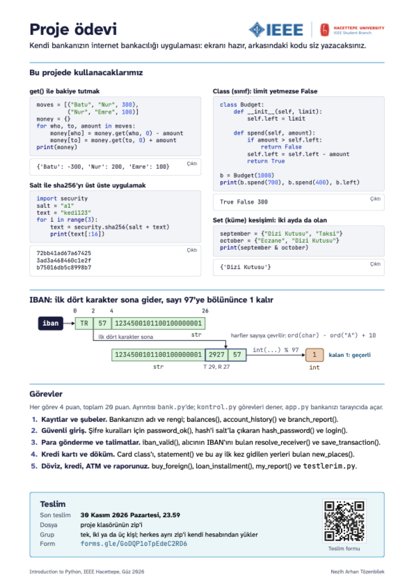</p>

Yukarıdaki kart projenin özeti. Aşağıda kurulum, Ders 5'in konularına kısa bir giriş, görevler, uygulamanın kullanımı ve projenin istediği konuların daha ayrıntılı tekrarı var.

## Klasörde neler var

| File | İçinde |
|---|---|
| `bank.py` | Bankanın motoru, sizin yazacağınız file. Her görev, function'ın docstring'inde, yani def satırının altındaki açıklamada yazıyor. Sonundaki "Hazır function'lar" bölümünü biz yazdık; uygulama oradaki function'ları da kullanıyor. |
| `testlerim.py` | 5. görevde kendi testlerinizi yazacağınız file. |
| `app.py` | Hazır: bankanın uygulaması. **Run** deyince bankanız tarayıcıda açılır; ekrandaki her sayı `bank.py`'deki function'lardan gelir. |
| `kontrol.py` | `bank.py`'de sizin yazdığınız function'ları küçük örneklerle dener, `testlerim.py`'yi çalıştırır ve her görevin yanına ✓ ya da ✗ yazar. |
| `security.py` | Hazır: bir şifrenin hash'ini çıkaran `sha256()` ve rastgele bir salt üreten `make_salt()`. 2. görevde kullanacaksınız; hash'in ve salt'ın ne olduğu aşağıda, [Şifre değil, hash](#şifre-değil-hash-banka-şifrenizi-neden-saklamaz) bölümünde. |
| `dates.py` | Hazır: bir tarihe gün ekleyen `add_days()` ve ay ekleyen `add_months()` gibi tarih hesapları. 4. görevde kullanacaksınız. |
| `records.py` | Hazır: `data` klasöründeki öbür file'ları okuyan function'lar; `app.py` ve `kontrol.py` kullanıyor. `transactions.csv`'yi okuyan `load_transactions` ise `bank.py`'nin sonunda hazır duruyor. |
| `ui/` | Hazır: uygulamanın ekranı (`index.html`, `app.js`, `style.css`). İnternetten bir şey yüklemez. |
| `data/` | Kurgusal müşteriler, hesaplar, şubeler, para hareketleri, kartlar, krediler ve kurlar; `data/initial/` bunların ilk halinin kopyası. Ayrıntısı `data/README.md`'de. |
| `img/` | Bu sayfadaki kart ve ekran görüntüleri. |
| `README.md` | Bu açıklama. Teslimden önce yerine kendi README'nizi koyacaksınız. |
| `README-sablon.md` | Kendi README'niz için şablon. |
| `GITHUB.md` | Projeyi isterseniz GitHub'da göstermek için adım adım rehber. |

`security.py`, `dates.py`, `records.py`, `app.py` ve `ui` klasöründekileri değiştirmeniz gerekmiyor. İçlerinde derste görmediğimiz şeyler var, ama siz yalnız `security.py` ile `dates.py`'deki function'ları çağıracaksınız. `bank.py`'nin sonundaki hazır function'ları da değiştirmeyin: uygulama onları olduğu gibi kullanıyor. Başındaki `import random` satırı da hazır `atm_withdraw` için orada; onu da silmeyin. Bir file'ı **Run** ettikten sonra klasörde `__pycache__` adlı bir klasör belirir: Python'un kendi kullandığı bir klasör, dokunmanız gerekmiyor.

<p align="center"></p>

## Kurulum

Python 3.14 ve PyCharm yeter. Proje yalnız Python'la gelen module'leri (modül) kullanıyor; paket, Jupyter ya da matplotlib kurmanız gerekmiyor.

1. Zip'ten çıkan klasörü olduğu gibi PyCharm'da açın: **File**, **Open**, klasörü seçin. File'ları klasörden ayırmayın; `bank.py`, `testlerim.py`, `app.py`, `kontrol.py`, `security.py`, `dates.py`, `records.py`, `ui` ve `data` aynı yerde durmalı.
2. PyCharm projeye güvenip güvenmediğinizi sorarsa **Trust Project** deyin. Bir interpreter (yorumlayıcı) sorarsa Ders 1'de kurduğunuz Python 3.14'ü seçin.
3. `app.py`'yi açıp **Run** deyin. Tarayıcınızda "Örnek Bank" adlı bir banka açılırsa kurulum tamam. Durdurmak için PyCharm'daki kırmızı **Stop** düğmesine basın.
4. `kontrol.py`'yi açıp **Run** deyin. İlk ✗ satırı ilk işinizi söyler: bankanıza bir ad vermek. Sonra `bank.py`'de `balances`'ın docstring'ini okuyun.

## Ders 5'ten önce: list, tuple, dict ve set

Bu bölümün sonunda görevlerin istediği dört yapıyı kullanabileceksiniz: hareketleri bir list'te toplayıp sıralamak, bir hareketi tuple'la tutup alanlarını ayrı isimlere açmak, bakiyeleri bir dict'te biriktirmek, gidilen yerleri bir set'te tekrarsız tutmak.

Bu dört konuyu Ders 5'te (17 Kasım) göreceğiz. Görevler onları kullanıyor; projeye Ders 4'ten sonra, Ders 5'i beklemeden başlamak isteyen herkes, tek başına ya da grubuyla, görevlerin istediği kadarını buradan öğrenip devam edebilir.

`bank.py`'de bunlardan birini isteyen her function'ın docstring'inde bir "Ders 5 notu" var: hangi yapının gerektiğini söylüyor ve buraya gönderiyor. Örnekleri proje klasöründe yeni bir file açıp (örneğin `deneme.py`) çalıştırabilirsiniz.

### List ve split()

List birçok değeri tek bir isimde, sırasıyla tutar; köşeli parantezle yazılır. İçindeki her değere item (eleman) denir.

Index (indis) str'deki (karakter dizisi) gibi 0'dan başlar, `[-1]` son item'ı verir; slicing (dilimleme) de str'deki gibi çalışır ve yeni bir list verir. `len()` item sayısını, `sum()` sayılardan oluşan bir list'in toplamını verir.

`append()` ve `insert()` list'in method'larıdır (metot) ve list'i yerinde değiştirir: `append()` sonuna, `insert(0, ...)` en başına bir item ekler.

Str method'larından farkı şu: `line = line.strip()` yeni bir str verdiği için sonucu yeniden atıyorduk; `append()` ve `insert()` ise yeni bir list vermez, list'in kendisini değiştirip None return eder. `amounts = amounts.append(50)` yazarsanız elinizde list değil None kalır.

`for` list'in item'larını sırayla verir.

```python
amounts = [120, 80, 300]
print(amounts[0], amounts[-1], amounts[:2])
print(len(amounts), sum(amounts))

amounts.append(50)
amounts.insert(0, 10)
print(amounts)

for amount in amounts:
    if amount > 100:
        print(amount)
```

```text
120 300 [120, 80]
3 500
[10, 120, 80, 300, 50]
120
300
```

<p align="center">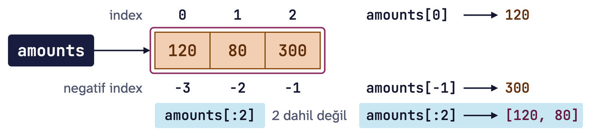</p>

`split()` da Ders 5'te: bir str'yi verdiğiniz ayırıcıdan böler ve parçaları bir list olarak verir. Parçalar str'dir; sayı gerekiyorsa `int()` ile çevrilir.

```python
parts = "2026-11-08,Zehra,250".split(",")
print(parts)
print(parts[1], int(parts[2]) + 50)
```

```text
['2026-11-08', 'Zehra', '250']
Zehra 300
```

### Tuple, unpacking ve sort()

Tuple da birkaç değeri bir arada tutar, ama parantezle yazılır ve sonradan değiştirilemez: alanları sabit bir kayıt için kullanılır, bir para hareketi gibi.

Index ve `len()` tuple'da da list'teki gibi çalışır, ama `move[2] = 300` TypeError verir. Bir alanı değişen kaydın yerine yeni bir tuple kurarsınız: `move = (date, name, 300)`; `change_password`'de müşterinin tuple'ını da böyle yenisiyle değiştirirsiniz.

Unpacking, bir tuple'ın item'larını tek satırda ayrı isimlere atar; list'te de aynen çalışır, `split()`'in verdiği list'i de böyle açarsınız: `date, name, amount = "2026-11-08,Zehra,250".split(",")`.

İsim sayısı item sayısına eşit olmalı, değilse ValueError verir; hazır `load_transactions` bozuk satırları bu hatayla yakalıyor.

for satırı da tuple'lardan oluşan bir list'in her tuple'ını böyle açar.

`sort()` tuple'lardan oluşan bir list'i küçükten büyüğe, önce ilk item'lara, onlar eşitse ikinci item'lara göre sıralar. `sort()` da list'in kendisini sıralar ve None return eder: `moves = moves.sort()` değil, yalnız `moves.sort()` yazın.

```python
move = ("2026-11-08", "Zehra", 250)
date, name, amount = move
print(name, amount)

moves = [("2026-11-09", "Emre", 40), ("2026-11-02", "Nur", 75)]
for date, name, amount in moves:
    print(date, name, amount)

moves.sort()
print(moves[0])
```

```text
Zehra 250
2026-11-09 Emre 40
2026-11-02 Nur 75
('2026-11-02', 'Nur', 75)
```

<p align="center">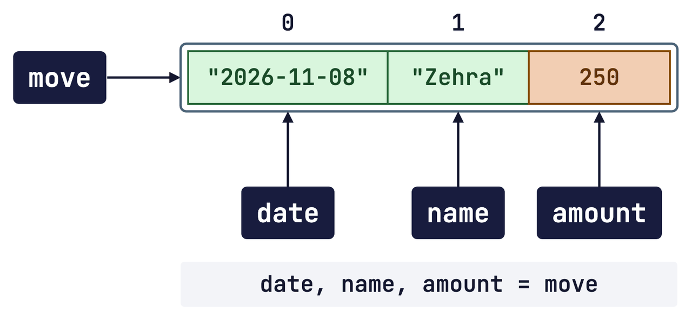</p>

Tarihler `2026-11-02` biçiminde yazıldığı için str olarak sıralanınca eskiden yeniye dizilir. Büyükten küçüğe sıralamanın yolu aşağıda, [Büyükten küçüğe sıralamak: 0 - total](#büyükten-küçüğe-sıralamak-0---total) bölümünde.

Görevlerin çoğu bir list'i boş başlatıp bir for'la doldurur; tıpkı bir toplamı `total = 0` ile başlatıp her turda büyüttüğünüz gibi. Boş bir list `[]` ile kurulur.

List'e bir tuple eklerken iki kat parantez yazılır: içteki tuple'ı kurar, dıştaki `append()`'in kendi parantezidir. `rows.append(date, name)` yazarsanız `append()` tek bir item yerine iki şey alır ve TypeError verir.

```python
moves = [("2026-11-09", "Emre", 40), ("2026-11-02", "Nur", 75)]
rows = []
for date, name, amount in moves:
    if amount > 50:
        rows.append((date, name))
rows.insert(0, ("2026-11-01", "Ali"))
print(rows)
```

```text
[('2026-11-01', 'Ali'), ('2026-11-02', 'Nur')]
```

### Dict

Dict bilgiyi çiftler halinde tutar: her key'in (anahtar) bir value'su (değer) var. Key'le aranır, value bulunur: aşağıdaki `balance`'ta key müşterinin adı, value bakiyesi. Süslü parantezle, `{key: value, key: value}` diye yazılır; boş bir dict `{}` ile kurulur.

`d[key]` o key'in value'sunu verir; `d[key] = value` key yoksa yeni bir çift ekler, varsa value'yu değiştirir. `in` yalnız key'lere bakar, value'lara bakmaz.

`get(key, 0)` key varsa value'sunu, yoksa ikinci yazdığınızı, burada 0'ı verir; olmayan bir key'i köşeli parantezle okumak ise KeyError verir.

for bir dict'te key'leri verir; `items()` her çifti bir `(key, value)` tuple'ı olarak verir, for satırı da onu iki isme açar.

```python
balance = {"Zehra": 4078, "Emre": 11168}
print(balance["Zehra"])
balance["Nur"] = 500
balance["Emre"] = balance["Emre"] + 100
print(balance)
print("Nur" in balance, 4078 in balance)
print(balance.get("Ali", 0))

for name in balance:
    print(name)
for name, money in balance.items():
    print(name, money)
```

```text
4078
{'Zehra': 4078, 'Emre': 11268, 'Nur': 500}
True False
0
Zehra
Emre
Nur
Zehra 4078
Emre 11268
Nur 500
```

<p align="center">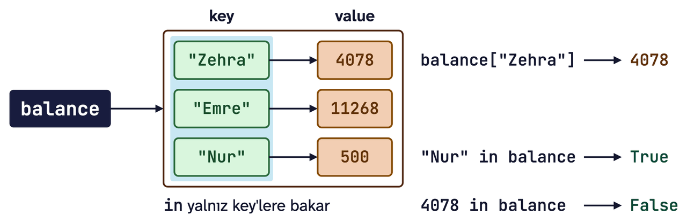</p>

Bir list'i ya da dict'i başka bir isme atadığınızda ya da bir function'a verdiğinizde kopyası çıkmaz; iki isim de aynı şeyi gösterir.

Function'ın içinde `append()` ya da `d[key] = value` ile yaptığınız değişikliği function'ı çağıran da görür: hazır `transfer` yeni hareketi `transactions` list'ine, `login` de deneme sayısını `failed` dict'ine bu yüzden return etmeden işler.

Parameter'a (parametre) `=` ile yeniden atama yapmak ise yalnız function'ın içindeki ismi değiştirir. Ayrı bir kopya gerekince ne yapılacağı aşağıda, [Aynı list, iki isim: copy()](#aynı-list-iki-isim-copy) bölümünde.

```python
def add_move(moves):
    moves.append(("2026-11-10", "Ali", 20))

my_moves = []
add_move(my_moves)
print(len(my_moves))
```

```text
1
```

### Set

Set her değeri bir kez tutar; sırası ve index'i yoktur.

İçi dolu bir set de süslü parantezle yazılır, ama iki nokta olmadan: `{"Kafe", "Kitapçı"}`, tek bir müşteri numarasıyla `{1001}`. Dict'te ise her key'den sonra iki nokta ve value'su gelir. Boş bir set `set()` ile kurulur, çünkü `{}` boş bir dict'tir.

`add()` set'e bir değer ekler; değer zaten varsa set değişmez. List'teki `append()` set'te yoktur, AttributeError verir. `in` bir değerin set'te olup olmadığına bakar.

`a | b` iki set'teki bütün değerleri, `a - b` a'da olup b'de olmayanları yeni bir set olarak verir.

```python
visited = set()
for place in ["Kafe", "Sinema", "Kafe"]:
    visited.add(place)
print(len(visited), "Kafe" in visited)

before = {"Kafe", "Kitapçı"}
print(visited - before)
print(len(visited | before))
```

```text
2 True
{'Sinema'}
3
```

<p align="center">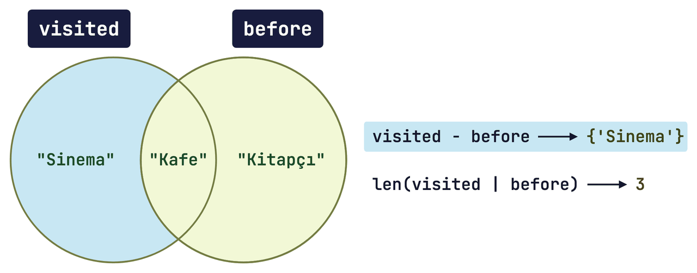</p>

Birden çok değeri olan bir set'i yazdırınca değerlerin sırası çalıştırmadan çalıştırmaya değişebilir; örnek bu yüzden `visited | before`'un yalnız büyüklüğünü yazdırıyor.

Artık bir list'i boş başlatıp doldurabilir ve sıralayabilir, bir tuple'ı ayrı isimlere açabilir, bir dict'te key'e göre toplayabilir, bir set'le tekrarları atabilirsiniz. Bu yapıların projede nerede işinize yarayacağı aşağıda: görev görev [Hangi konu nerede?](#hangi-konu-nerede) tablosunda, örnekleriyle [Bu projede kullanacaklarımız](#bu-projede-kullanacaklarımız) bölümünde.

## Görevler

Beş görev var; her görev 4 puan. `kontrol.py`'nin ✓ verdiği ve ana fikri yerinde olan görev 4 puan; ✗ kalan bir görevde de yazdıklarınıza okuyarak bakılır. Doldurulmuş README'niz ve iki ekran görüntüsü de 5. görevin puanına girer.

Ayrıntısı `bank.py`'de, function'ların docstring'inde. Bir görevin ekrandaki bölümü, o görevi yazınca açılır. Bazı function'lar hazır geliyor: `bank.py`'nin sonunda, "Hazır function'lar" başlığının altında duruyorlar ve uygulama onları da kullanıyor. Görevlerin en uzun ve en çok kural içeren dört function'ı da orada: `load_transactions`, `transfer`, `due_orders` ve `atm_withdraw`. Onları siz yazmayacaksınız, değiştirmeyin de; okumak, görevlerin fikirlerini başka bir yerde görmenin iyi bir yolu. Hazır bir function başka bir görevdeki function'ınızı çağırıyorsa, onun bölümü o görevi de bekler: para gönderme, 1. ve 3. görev yazılınca çalışır. ATM'den para çekme ise 5. görevle çalışır; hazır `atm_withdraw` 1. ve 3. görevdeki function'larınızı çağırdığı için o görevleri de bekler.

1. **Kayıtlar ve şubeler.** Yazacaklarınız: bankanızın adı ve rengi (`BANK_NAME`, `BANK_COLOR`); her hesabın bakiyesini bulan `balances`; bir hesabın hareketlerini en yenisi başta bulan `account_history`; bir IBAN'ın sahibini veren `owner_of`; her şubenin müşteri sayısını ve toplam parasını veren `branch_report`.\
   Hazır gelenler: `transactions.csv`'yi bozuk satırları atlayıp sayarak okuyan, file yoksa boş başlayan `load_transactions` (bu görevin function'ları onun verdiği hareketlerle çalışıyor) ve her ay giren ve çıkan parayı bulan `monthly_flow`.
2. **Güvenli giriş.** Yazacaklarınız: yeni bir şifrenin bankanın kurallarına uyup uymadığına bakan `password_ok`; `bank.py`'nin başına `import security` yazdıktan sonra şifrenin hash'ini salt'la ve `ROUNDS` turla çıkaran `hash_password`; yeni müşteriyi kaydeden `register`; üst üste üç yanlış denemede hesabı kilitleyen `login`; şifreyi değiştiren `change_password`.\
   Hazır gelenler: `bank.py`'de bu görevin hazır bir function'ı yok; `security.py`'deki `sha256()` ve `make_salt()` hazır.
3. **Para gönderme ve talimatlar.** Yazacaklarınız: IBAN'ın kontrol hanelerine bakan `iban_valid`; başkasının IBAN'ını yıldızlayan `mask_iban`; Kolay Adres'i (e-posta) IBAN'a çeviren `resolve_receiver`; hareketi file'a yazan `save_transaction`.\
   Hazır gelenler: bakiyeye ve günlük limite bakıp parayı aynı şubeye masrafsız, başka şubeye 2 TL, başka bankaya 5 TL masrafla gönderen `transfer`; günü gelen otomatik ödeme talimatlarını veren `due_orders` (uygulama onları `transfer` ile öder); hesabınıza yeni bir Kolay Adres bağlayan `add_alias` ve son gönderdiklerinizi tutan `update_recent`. `transfer` sizin yazdığınız dört function'ı çağırıyor: `iban_valid` ve `save_transaction` (3. görev), `balances` ve `owner_of` (1. görev).
4. **Kredi kartı ve döküm.** Yazacaklarınız: kartın limitini ve borcunu tutan `Card` class'ı (sınıf); hareketleri sırayla uygulayan `replay_card`; ekstreyi çıkaran `statement`; `bank.py`'nin başına yazacağınız `import dates` ile asgari ödemeyi ve son ödeme gününü bulan `payment_info`; döküm için kategori toplamlarını bulan `category_totals`, bir ayda gidilen yerleri bulan `places` ve bu ay ilk kez gidilen yerleri bulan `new_places`; bir alışverişin taksitlerini veren `installments`.\
   Hazır gelenler: çift çekimleri yakalayan `double_charges`; en çok harcanan kategorileri, abonelikleri ve bütçe uyarılarını bulan `top_categories`, `subscriptions` ve `budget_warnings`.
5. **Döviz, kredi, ATM ve raporunuz.** Yazacaklarınız: döviz alım satımını hesaplayan `buy_foreign` ve `sell_foreign`; kur satırını yazan `rate_text`; birikim hedefine kaç ayda varılacağını bulan `months_to_goal`; kredi taksitini bulan `loan_installment`; Raporum sekmesindeki kendi raporunuzu hazırlayan `my_report`. `testlerim.py`'ye de en az beş assert ve bir IBAN deneme loop'u (döngü) yazarsınız.\
   Hazır gelenler: QR ile kartsız para çeken `atm_withdraw`; kur makasını hesaplayan `spread_loss`, mevduat faizini bulan `deposit_interest`, ödeme planını çıkaran `payment_plan`, yaklaşan ödemeleri veren `upcoming_payments`, ATM'nin vereceği banknotları bulan `banknotes` ve bir kart numarasının kontrol hanesine bakan `luhn_valid`. `atm_withdraw` bakiyeye `balances` (1. görev) ile bakıp çekimi `save_transaction` (3. görev) ile yazıyor; işlem numarası için gereken `import random` satırı `bank.py`'nin başında hazır duruyor.

<p align="center">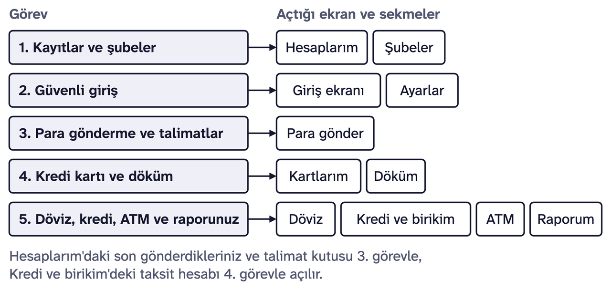</p>

Hepsi yalnızca Ders 1, 2, 3, 4 ve 5'te gördüğümüz yapılarla yapılabiliyor. Ders 5'i beklemeden, yalnız Ders 1-4'le yazabilecekleriniz şunlar: `password_ok`, `hash_password`, `iban_valid`, `mask_iban`, `Card`, `payment_info`, `buy_foreign`, `sell_foreign`, `rate_text`, `loan_installment` ve `months_to_goal`. Bunlarla başlayıp 17 Kasım'dan, yani Ders 5'ten sonra 1. görevle devam edebilirsiniz. Ders 5'in yapılarını isteyen function'larda bir "Ders 5 notu" var; kısa anlatımları yukarıda, [Ders 5'ten önce](#ders-5ten-önce-list-tuple-dict-ve-set) bölümünde. Hangi konunun nerede işinize yarayacağı aşağıda, [Hangi konu nerede?](#hangi-konu-nerede) bölümünde.

Bilmediğiniz bir bankacılık sözcüğü (IBAN, ekstre, hesap kesim, asgari ödeme, kur makası gibi) görürseniz [Bankacılık sözcükleri](#bankacılık-sözcükleri) tablosuna bakın.

## Bitince böyle görünecek

Aşağıdaki görüntüler bütün görevleri yazılmış bir bankadan. Sizin bankanızın adı ve rengi başka olacak; son ekstre, yaklaşan ödemeler ve kurlar gibi bugünün tarihine bağlı bölümler de sizde başka görünebilir.

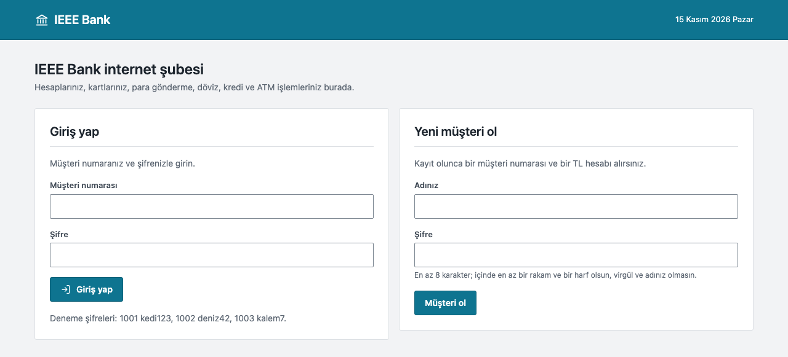

**Giriş (2. görev):** müşteri numarası ve şifreyle giriş; yeni müşteri formu da burada.


**Hesaplarım (1. görev):** bakiyeler, hesap hareketleri, her ay giren ve çıkan para; şubeniz, Kolay Adresiniz, atlanan bozuk satır sayısı ve son gönderdikleriniz (3. görev). Üstteki kutu o gün çalışan otomatik ödeme talimatını gösteriyor (3. görev); görüntüdeki Fatih'in ayın 15'indeki harçlık talimatı.

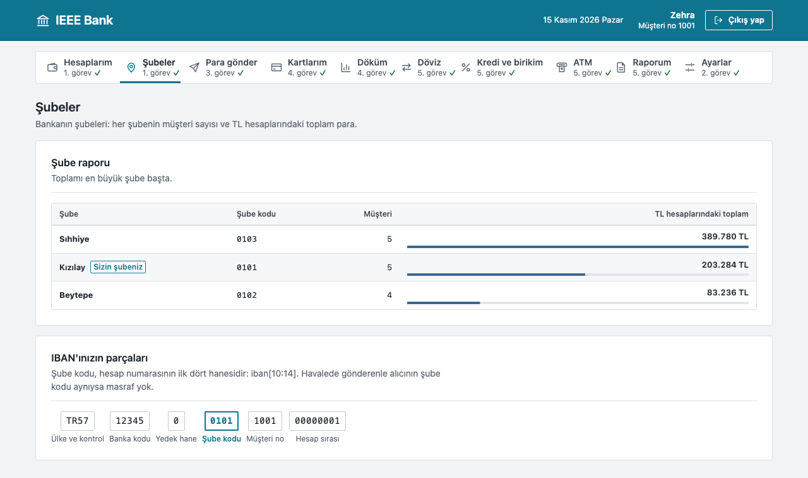

**Şubeler (1. görev):** her şubenin müşteri sayısı ve TL hesaplarındaki toplam para, en büyüğü başta; altta IBAN'ınızın parçaları ve şube kodu.

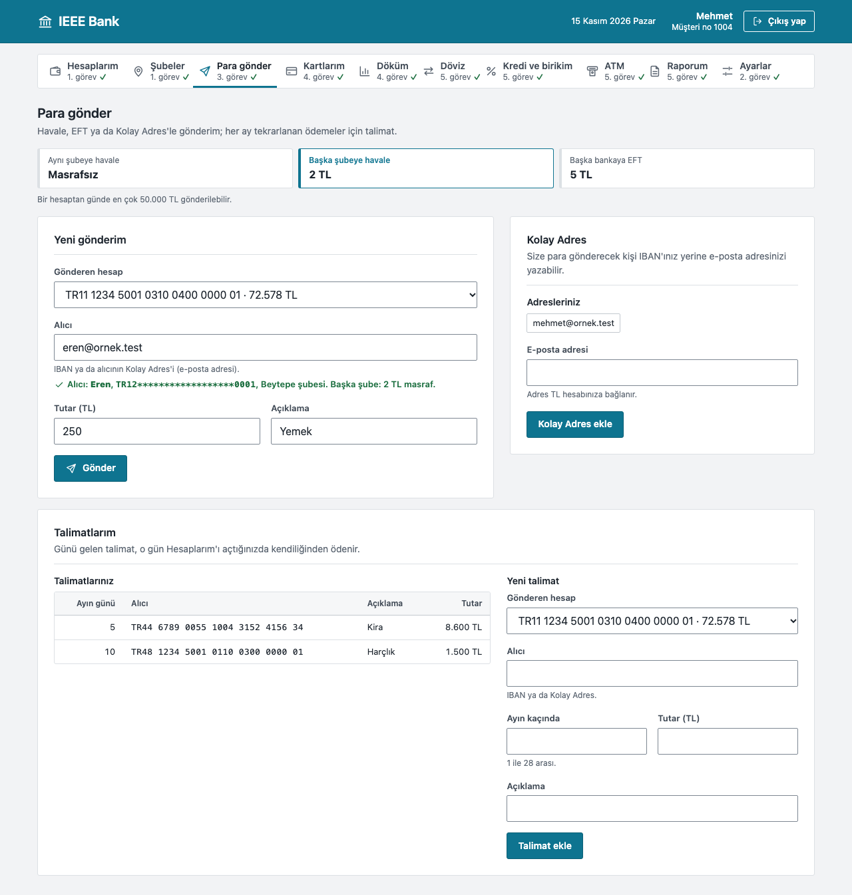

**Para gönder (3. görev):** IBAN ya da Kolay Adres'le havale ve EFT, şubeye ve bankaya göre masraf, Kolay Adres ekleme; altta talimatlarınız.

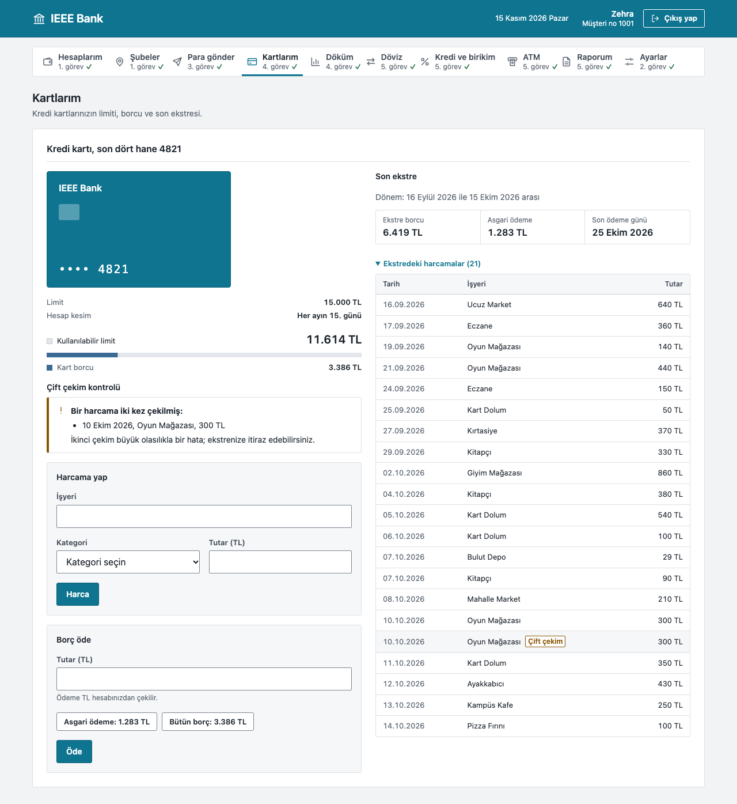

**Kartlarım (4. görev):** limit, kullanılabilir limit, borç, son ekstre, asgari ödeme, son ödeme günü ve çift çekim; harcama yapmak ve borç ödemek.

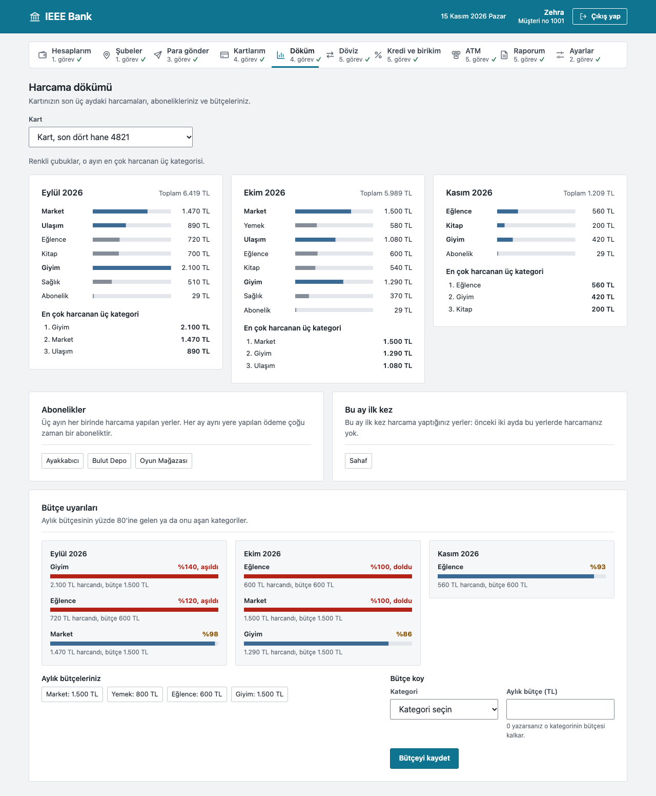

**Döküm (4. görev):** son üç ayın kategori toplamları ve en çok harcanan üç kategori, abonelikler, bu ay ilk kez gidilen yerler, bütçe uyarıları ve bütçe koyma.

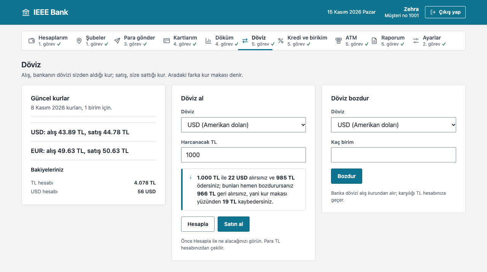

**Döviz (5. görev):** günün kurları, alım teklifi ve kur makası, döviz alma ve bozdurma.

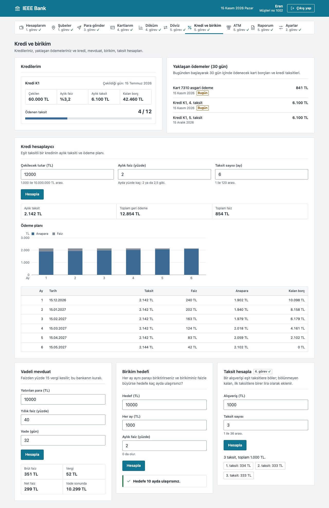

**Kredi ve birikim (5. görev):** krediler ve yaklaşan ödemeler, kredi hesaplayıcı ve ödeme planı, vadeli mevduat, birikim hedefi ve taksit hesabı (4. görev).

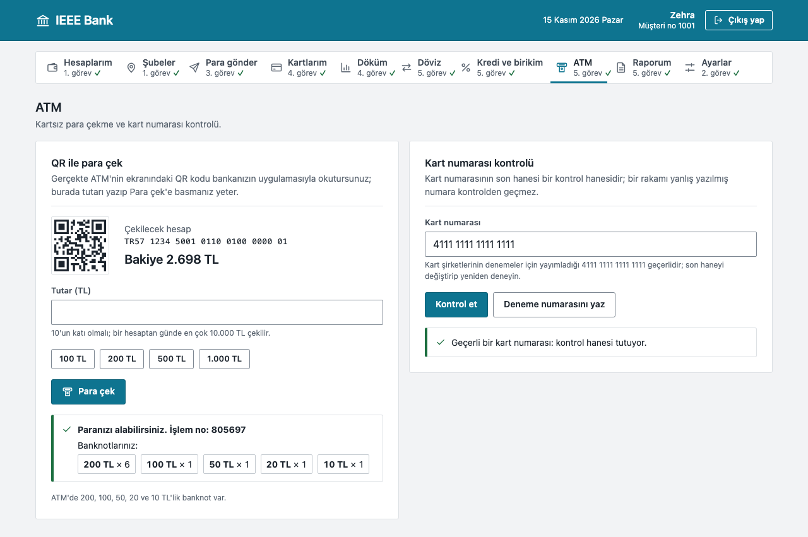

**ATM (5. görev):** QR ile kartsız para çekme, ATM'nin verdiği banknotlar ve işlem numarası; kart numarası kontrolü.

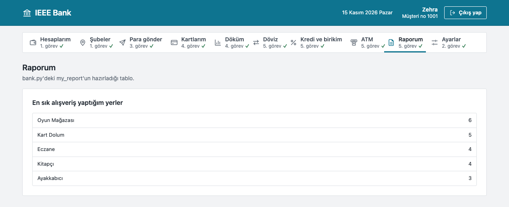

**Raporum (5. görev):** `my_report`'un tablosu. Buradaki rapor bizim örneğimiz; sizinki kendi fikriniz olacak.

## Nasıl çalışılır

Görevleri sırayla yapın. Her görevde:

1. `bank.py`'de o görevin function'larının docstring'ini okuyun. Örneklerde `>>>` ile başlayan satırı Python çalıştırır; bu satır çoğu zaman bir call (çağrı). `...` ile başlayan satırlar onun devamıdır: uzun bir satır böyle bölünür. Başında `>>>` ya da `...` olmayan satır call'un return ettiği değerdir; örnekte print varsa ekrana yazılandır. `rows = [...]` gibi bir isme değer atayan satırın altında bir şey yazmaz.
2. `# TODO` satırını ve `pass`'i silip yerlerine kodunuzu yazın.
3. `kontrol.py`'yi açıp **Run** deyin. Görevin yanına ✓ gelince sıradakine geçebilirsiniz; ✗ gelirse aynı satırda, görevin adının yanında neyin eksik olduğu yazar.
4. Uygulamada görevin bölümüne bakın. `app.py` zaten çalışıyorsa tarayıcıda sayfayı yenilemeniz yeter.

<p align="center"></p>

**Grupla çalışıyorsanız:** tek bir `bank.py` tutun. Herkes kendi yazdığı function'ları bu file'a yapıştırır; iki kişi file'ı aynı anda değiştirmez. 1. görevi önce birlikte bitirin, çünkü hazır `transfer` ve `atm_withdraw` 1. görevin `balances`'ını kullanıyor.

### Uygulama

`app.py`'yi **Run** deyince bankanız tarayıcınızda http://127.0.0.1:8000 adresinde açılır. 127.0.0.1 bilgisayarınızın kendisi demek: uygulama yalnız sizin bilgisayarınızda çalışır, internete bir şey gönderilmez. Adres Run penceresinde de yazar; tarayıcı kendiliğinden açılmazsa o adresi tarayıcıya yazın. 8000 doluysa uygulama 8001 gibi sıradaki adresi kullanır.

Bankaya müşteri numarası ve şifreyle girilir. Deneme için üç müşteri:

| Müşteri no | Ad | Şifre | Şube |
|---|---|---|---|
| 1001 | Zehra | `kedi123` | Kızılay |
| 1002 | Eren | `deniz42` | Beytepe |
| 1003 | Emre | `kalem7` | Kızılay |

Zehra'nın bir USD hesabı ve bir kredi kartı var, kartında bir çift çekim duruyor. Eren'in bir EUR hesabı, bir kredisi ve her ayın 5'inde ödenen bir kira talimatı var. Emre'ye her ayın 10'unda Mehmet'ten harçlık geliyor (Mehmet Hesaplarım'ı açınca ödenir).

Şifre, 2. görevi yazana kadar sorulmaz: giriş ekranındaki listeden bir müşteri seçip girersiniz. 2. görevi yazınca giriş numara ve şifreyle olur; yeni müşteri formu ve Ayarlar'daki şifre değiştirme de çalışır. Yeni müşterinin TL hesabına 1.000 TL hoş geldin hediyesi yatar. Yeni şifreler `password_ok`'un kurallarına uymalı: en az 8 karakter, en az bir rakam ve bir harf, virgül yok, adınız içinde geçmiyor. Yukarıdaki deneme şifreleri bu kurallardan önce konmuş; kurallar yalnız yeni şifrelere uygulanır. Başka bir yerde kullandığınız bir şifreyi yazmayın, deneme için uydurun.

- **bank.py'yi değiştirince:** kaydedip tarayıcıda sayfayı yenilemeniz yeter; cevap gelmeyen bir istek dışında `app.py`'yi yeniden başlatmanız gerekmez. `app.py` durmuşken sayfa uygulamaya ulaşılamadığını söyler; `app.py`'yi yeniden **Run** deyip sayfayı yenileyin.
- **Bitmeyen loop:** `bank.py`'deki bir loop bitmezse `app.py` o function'ı yarıda keser ve sayfada function'ın adını ve satırını gösterir; loop'u düzeltip sayfayı yenilemeniz yeter. Sayfa cevap gelmediğini ya da önceki isteğin bitmediğini söylerse, örneğin `bank.py`'deki bir `input()` cevap bekliyorsa, düzeltin, sonra `app.py`'yi **Stop** ile durdurup yeniden **Run** deyin; bu durumda sayfayı yenilemek yetmez.
- **"N. görevi yazınca açılacak":** henüz yazmadığınız bir görevin bölümünde bu kutu durur; N, bölümün bağlı olduğu görevin numarası. Kutu hangi function'ı yazmanız gerektiğini de söyler. Görevi yazıp sayfayı yenileyince bölüm açılır. Bir düğme henüz yazmadığınız bir göreve bağlıysa "Bu işlem N. görevi yazınca çalışacak" yazar. Hazır bir function sizin bir function'ınızı çağırıyorsa, onun bölümü de sizin görevinizle açılır: hazır `payment_plan` `loan_installment`'ı çağırdığı için ödeme planı 5. görevle açılır. Hazır `transfer` da 1. ve 3. görevdeki function'larınızı çağırıyor; para gönderme onlar yazılınca çalışır, kutu da sıradaki eksik function'ı söyler. İki bölüm ise hazır bir function'la çalışsa da sekmesinin görevini bekler: Hesaplarım'daki aylık giren ve çıkan, hesaplar ve hareketler gibi `balances` ve `account_history` yazılınca açılır; ATM'den para çekme 5. görevle çalışır. ATM'de kutu önce 5. görevde henüz yazmadığınız ilk function'ı söyler; 5. görev bitince sıra, hazır `atm_withdraw`'ın çağırdığı `balances`'a (1. görev) ve `save_transaction`'a (3. görev) gelir.
- **Hata kutusu:** function'ınız hata verirse bölümde bir hata kutusu çıkar: function'ın adı, hata ve hatanın `bank.py`'deki satırı. PyCharm'da o satıra gidip düzeltin; satır numaraları editörün solunda yazar. Function'ınız beklenenden başka bir şey return ederse kutu ne beklendiğini söyler. Hazır bir function'ın çağırdığı function'ınız hata verirse kutu yine sizin function'ınızın adını ve satırını gösterir. Hata hazır kodun kendi satırında çıkarsa, çağırdığı function'larınızdan biri yanlış bir değer, örneğin None, return ediyor olabilir: `kontrol.py`'yi çalıştırın. `bank.py`'nin başındaki hazır `import random` satırı silinmişse ATM para vermez, kutu da satırın silindiğini söyler; satırı yerine geri koyun. `bank.py` hiç import edilemiyorsa (örneğin bir parantez kapanmamışsa) hiçbir bölüm açılmaz; hata ve satırı sayfanın en üstünde yazar.
- **Kilit:** üst üste üç yanlış şifre girilen hesap kilitlenir; bu 2. görevin kuralı. Kilit, `app.py`'yi durdurup yeniden başlatınca ya da verileri ilk haline döndürünce açılır.
- **Verileri ilk haline döndür:** uygulamada yaptığınız her işlem `data` klasöründeki file'lara yazılır: gönderdiğiniz para `transactions.csv`'ye, yeni müşteri `customers.csv`'ye, kart harcaması `card_activity.csv`'ye eklenir. Denemelerden sonra her şeyi başa almak için sayfanın en altındaki bu düğmeye basıp onaylayın: `data/initial/`'daki kopyalar geri yüklenir, herkesin oturumu kapanır ve kilitler açılır.
- **Bugünün tarihi:** uygulama bilgisayarınızın tarihini kullanır; son ekstre, yaklaşan ödemeler ve kurlar ona göre seçilir. Veri 7 Kasım 2026'da bitiyor, kurlar 8 Kasım'da; daha sonraki günlerde uygulama son kuru kullanır.
- **Talimatlar:** bir otomatik ödeme talimatının günü gelince, talimatı veren müşteri Hesaplarım'ı açtığında uygulama ödemeyi hazır `due_orders` ve `transfer` ile yapar ve Hesaplarım'da bugün ödenenleri yazar. Denemek için Para gönder'in altındaki Talimatlarım'dan bugünün gününe bir talimat ekleyip Hesaplarım'ı yeniden açın.

### testlerim.py

`testlerim.py` de 5. görevin parçası. Orada `bank.py`'deki function'larınızı kendiniz denersiniz: en az beş assert, sonra "Bütün testler geçti." yazan bir print ve bir IBAN deneme loop'u yazarsınız; ayrıntısı file'ın başındaki açıklamada. File'ı açıp **Run** deyin. Assert'lerin hepsi tutarsa "Bütün testler geçti." yazar ve bir IBAN sorar; IBAN'ı yazıp Enter'a basınca "Geçerli" ya da "Geçersiz" yazar. Boş bir satır, yani yalnız Enter, loop'u bitirir. Run penceresi şöyle görünür:

```text
Bütün testler geçti.
IBAN (çıkmak için boş bırakın): TR57 1234 5001 0110 0100 0000 01
Geçerli
IBAN (çıkmak için boş bırakın): TR57 1234 5001 0110 0100 0000 02
Geçersiz
IBAN (çıkmak için boş bırakın):
```

Bir assert tutmazsa program AssertionError ile durur ve hangi satırda durduğunu söyler.

### Kendinizi denemek için

Veriler ilk halindeyken ve görevler doğru yazılmışsa:

- 1001 numaralı Zehra'nın TL hesabının bakiyesi 4.078 TL, USD hesabınınki 56 USD (1. görev); hazır `load_transactions`'ın atladığı bozuk satır sayısı 6.
- Şubeler raporunda sıra Sıhhiye, Kızılay, Beytepe; müşteri sayıları 5, 5 ve 4 (1. görev).
- Zehra'nın 4821 numaralı kartının borcu 3.386 TL (4. görev); hazır `double_charges`'ın bulduğu çift çekim 10 Ekim 2026'da Oyun Mağazası'ndan 300 TL.

## Kendi kendinize kontrol

`kontrol.py`'yi PyCharm'da açıp **Run** deyin. `bank.py`'yi import eder, her görevde sizin yazdığınız function'ları küçük örneklerle dener ve her görevin yanına ✓ ya da ✗ yazar; hazır function'lara bakmaz. ✗'in yanında, aynı satırda neyin eksik olduğu yazar; hata varsa hatanın `bank.py`'nin hangi satırında olduğunu da söyler. En altta kaç görevin geçtiği yazar. 5. görevde `testlerim.py`'yi de çalıştırır: en az beş assert olduğuna, bunların en az üç farklı function'ı denediğine, "Bütün testler geçti." yazdığına ve IBAN loop'unun çalıştığına bakar.

`data` klasöründeki file'larınıza dokunmaz: function'larınızı kendi geçici deneme file'larıyla, ayrı bir klasörde dener; uygulamayı da açmaz. Sonucu elle yazarsanız bunu da fark eder, çünkü function'larınızı docstring'deki örneklerin yanında başka girdilerle de dener. Kontrol not vermez, yol gösterir. Beş görev de geçtiyse verilerini file'larda tutan, şifre yerine hash saklayan, IBAN'ı kontrol hanelerine göre denetleyen ve kendi testleriyle sınanan bir program yazabiliyorsunuz demektir.

Puanlamada `kontrol.py`'nin ✓ verdiği ve ana fikri yerinde olan görev tam puan alır. Banka adını ve rengini değiştirmek 1. görevin parçası. Doldurulmuş README'niz ve iki ekran görüntüsü de 5. görevin parçası; okunarak bakılır. `my_report` için `kontrol.py` yalnız biçime bakar: title boş olmayan bir str olmalı ve docstring'deki örneğin başlığı olmamalı, rows da tuple'ların list'i olmalı. Raporunuz kartı olmayan bir müşteride (activity boş bir list) ve yeni açılmış bir hesapta da çalışmalı; bir şeyi bölüyorsanız bölmeden önce bölenin 0 olmadığına bakın. Raporun sizin fikriniz olup olmadığına ve `testlerim.py`'deki assert'lerin docstring örneklerinin kopyası olup olmadığına okuyarak bakılır.

## Bankacılık sözcükleri

| Sözcük | Anlamı |
|---|---|
| Bakiye | Bir hesapta duran para. |
| Şube ve şube kodu | Şube, bankanın müşterilerine hizmet verdiği yerlerden biri; her hesap bir şubeye bağlı. Bu bankanın üç şubesi var: 0101 Kızılay, 0102 Beytepe ve 0103 Sıhhiye. Şube kodu, IBAN'daki hesap numarasının ilk dört hanesi. |
| Havale | Aynı bankadaki bir hesaba para göndermek. Bu bankada aynı şubeye havale masrafsız. |
| Şubeler arası havale | Aynı bankada başka bir şubedeki hesaba para göndermek. Bu bankada 2 TL masrafı var. |
| EFT | Başka bir bankadaki hesaba para göndermek; açılımı elektronik fon transferi. Bu bankada 5 TL masrafı var. |
| IBAN | Bir banka hesabının uluslararası numarası. Türkiye'de 26 karakter: TR, 2 kontrol hanesi, 5 haneli banka kodu, 1 yedek hane ve 16 haneli hesap numarası. Bu projede bizim bankanın kodu 12345, öbür bankanınki 67890; hesap numarası şube kodundan (4 hane), müşteri numarasından (4 hane) ve hesabın sırasından (8 hane) oluşuyor. |
| Kolay Adres | Para gönderirken IBAN yerine yazılabilen kısa bir adres. Gerçekte telefon numarası ya da e-posta gibi adresler kullanılıyor; bu projede basitleştirildi: yalnız e-posta var ve adresler `zehra@ornek.test` gibi `.test` ile bitiyor. `.test` denemelere ayrılmış bir alan adı, hiçbir gerçek adrese gitmez. |
| Günlük limit | Bir hesaptan bir günde gönderilebilecek en çok para. Bu bankada 50.000 TL. |
| Otomatik ödeme talimatı | Her ayın belli bir gününde aynı hesaba aynı tutarın kendiliğinden gönderilmesi; kira gibi. |
| QR ile ATM'den para çekme | Kart olmadan para çekmek: bankanın uygulamasında tutarı yazarsınız, ATM'nin ekranındaki kare kodu (QR) telefonunuzla okutursunuz ve ATM parayı verir. Bu uygulamada gerçek bir ATM yok; çekim ekranda canlandırılıyor. Bu bankada tutar 10'un katı olmalı ve bir hesaptan bir günde ATM'den en çok 10.000 TL çekilir. |
| Banknot | Kağıt para. Bu bankanın ATM'si 200, 100, 50, 20 ve 10 TL'lik banknot verir, önce büyüklerden. |
| İşlem no | Bankanın bir işleme verdiği numara; bir sorun olursa bankaya bu numarayla sorulur. Bu projede rastgele altı haneli bir sayı. |
| Limit ve kullanılabilir limit | Limit, kredi kartıyla harcanabilecek en çok para; kullanılabilir limit, limitten borç çıkınca kalan. |
| Hesap kesim | Kredi kartının harcamalarının toplanıp ekstrenin çıkarıldığı gün. Her kartın kendi günü var. |
| Ekstre | İki hesap kesim arasındaki harcamaların dökümü ve toplamı, yani o dönemin borcu. |
| Asgari ödeme | Ekstre borcunun son ödeme gününe kadar en az ödenmesi gereken kısmı. Bu bankada borcun yüzde 20'si. |
| Son ödeme günü | Ekstrenin ödenmesi gereken son gün. Bu bankada hesap kesimden 10 gün sonra. |
| Çift çekim | Aynı harcamanın karttan yanlışlıkla iki kez çekilmesi: aynı gün, aynı yerde, aynı tutar. |
| Abonelik | Her ay aynı yere kendiliğinden yapılan ödeme; dizi ya da müzik aboneliği gibi. |
| Bütçe | Bir kategoriye bir ayda en çok ne kadar harcamak istediğiniz. Uygulama, harcama bütçenin yüzde 80'ine gelince uyarır. |
| Luhn kontrolü | Kart numarasının son hanesi bir kontrol hanesidir; Luhn kontrolü bir rakamı yanlış yazılmış numarayı yakalar. Denemelerde yalnız kart şirketlerinin deneme için yayımladığı `4111 1111 1111 1111` gibi numaraları kullanın, gerçek bir kart numarası yazmayın. |
| Alış ve satış kuru | Bankanın dövizi sizden aldığı (alış) ve size sattığı (satış) fiyat. Satış kuru alıştan yüksektir. |
| Kur makası | Alış ve satış kuru arasındaki fark; banka kazancını buradan yapar. Dövizi alıp hemen bozdurursanız bu fark kadar kaybedersiniz. |
| Vadeli mevduat | Belli bir gün sayısı için bankaya bırakılan ve faiz getiren para. Faizden vergi kesilir; bu bankada yüzde 15. |
| Birikim hedefi | Her ay belli bir para ayırarak varmak istediğiniz tutar. Birikim aylık faizle de büyüyebilir; uygulama hedefe kaç ayda varacağınızı hesaplar. |
| Eşit taksitli kredi | Her ay aynı tutarın ödendiği kredi. |
| Anapara | Krediyle çekilen paranın kendisi, faiz hariç. |
| Faiz | Borç para kullanmanın bedeli. Eşit taksitli kredide her ay kalan anaparanın faizi ödenir; taksitin geri kalanı anaparayı azaltır. Mevduatta ise faizi banka size öder. |
| Taksit | Bir alışverişin tutarının eşit parçalara bölünüp ay ay ödenmesi. Bu bankada bölünmeyen kalan, ilk taksitlere birer TL olarak eklenir. |

Bu bankanın sayıları kurgusal ve `bank.py`'nin başındaki sabitlerde yazıyor: başka bir şubeye havale masrafı 2 TL (`BRANCH_FEE`), EFT masrafı 5 TL (`EFT_FEE`), günlük limit 50.000 TL (`DAILY_LIMIT`), ATM'den günde en çok 10.000 TL (`ATM_LIMIT`), asgari ödeme borcun yüzde 20'si (`MIN_PERCENT`), son ödeme günü hesap kesimden 10 gün sonra (`DUE_DAYS`), mevduat faizinden yüzde 15 vergi (`TAX_PERCENT`), son gönderdikleriniz listesinde en çok 5 alıcı (`RECENT_SIZE`). Bu sabitleri değiştirmeyin; ekrandaki yazılar ve `kontrol.py` bu sayılara göre. Kurlar da uyduruldu. Bunlar bu bankanın, yani bu ödevin kuralları; gerçek bir bankanın ücretlerini ya da mevzuatı anlatmıyorlar.

<p align="center">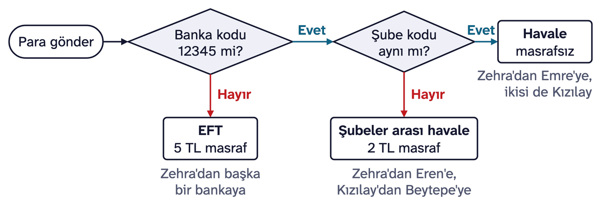</p>

<p align="center">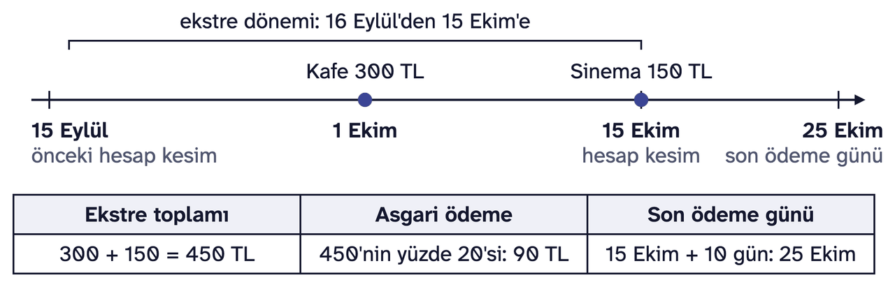</p>

## Şifre değil, hash: banka şifrenizi neden saklamaz

Bir banka şifrenizi hiçbir yere yazmaz. `data/customers.csv`'ye bakın: her satırda müşteri numarası, ad, bir salt ve bir hash var; şifre yok. File bir gün çalınsa ya da yanlışlıkla paylaşılsa bile şifreler onunla gitmez, bankanın çalışanları da şifrenizi göremez. Şifresini unutan müşteriye banka eski şifresini söyleyemez, çünkü kendisi de bilmiyor; yalnız yeni bir şifre belirlemesini ister.

**Hash bir parmak izi gibidir.** `security.sha256()` her şifreden 64 karakterlik bir str çıkarır. Aynı şifre her zaman aynı hash'i verir, tek bir karakter değişince bambaşka bir hash çıkar ve hash'ten şifreyi geri bulmanın bilinen bir yolu yok. Giriş yapılırken girilen şifrenin hash'i yeniden çıkarılır ve saklanan hash'le karşılaştırılır; eşitse şifre doğrudur. Aşağıdaki programı proje klasöründe yeni bir file'da (örneğin `deneme.py`) çalıştırın; `security.py` aynı klasörde olmalı.

```python
import security

print(security.sha256("kedi123"))
print(security.sha256("kedi124"))
print(security.sha256("9f2c41d07ab3e5c8" + "kedi123"))
print(security.sha256("5d03b8e14fa27c69" + "kedi123"))
```

```text
f2bd50407c5e5e69a4dddd029dc1e5ad39a66f1f59bd7a1a17bd4bd20118805a
6d2ba67fbbe65bf96707032b686dad95556a19582017411e5919a516ad18e4d4
33731366fb49c37cf2a9f8ebb5a495d69d4c5a290be5f0d50455b81a3f65eeb1
bc30235aed4a770c3a6430a5d934ce7e4360be1133b8e470b0d6e2936747229b
```

İlk iki satır, yalnız son karakteri farklı iki şifrenin hash'i; birbirine hiç benzemiyorlar.

**Salt neden var?** Salt olmasaydı aynı şifreyi seçen iki müşterinin hash'i de aynı çıkardı. File'ı ele geçiren biri bir şifreyi bulunca aynı hash'i taşıyan herkesinkini bulmuş olurdu; sık kullanılan şifrelerin hash'lerini önceden hesaplayıp hazır bir liste de tutabilirdi. Salt, her müşteriye özel rastgele bir str; hash'i çıkarılmadan önce şifrenin önüne eklenir. Yukarıdaki son iki satır aynı şifrenin iki ayrı salt'la verdiği hash'ler: onlar da bambaşka. Salt gizli değil, `customers.csv`'de hash'in yanında duruyor, çünkü girişte aynı hesap aynı salt'la yeniden yapılacak.

**ROUNDS neden var?** SHA-256 çok hızlı bir hesap; şifreleri tek tek deneyen biri için de hızlı. `hash_password` bu hesabı `ROUNDS` kez (bu projede 1000) üst üste yapar: her tur salt'ı bir önceki turun sonucunun önüne ekleyip onun hash'ini alır. Doğru şifreyi giren müşteri için bu bir kez yapılır ve fark edilmez; şifreyi tahmin etmeye çalışan biri ise her tahmin için 1000 tur hesaplamak zorunda kalır, yani 1000 kat yavaşlar.

<p align="center"></p>

Gerçek sistemler bu iş için yavaş olsun diye tasarlanmış standart yöntemler kullanır; Python'un `hashlib` module'ündeki `pbkdf2_hmac` (PBKDF2) bunlardan biri ve o da aynı iki fikre, salt'a ve çok sayıda tura dayanır.

**Projede:** 2. görevin `hash_password`'ü şifrenin hash'ini salt'la ve `ROUNDS` turla çıkarıyor. `register` yeni müşteriye `security.make_salt()` ile bir salt veriyor ve `customers.csv`'ye şifreyi değil, salt'ı ve hash'i yazıyor. `login` girilen şifrenin hash'ini müşterinin kendi salt'ıyla yeniden çıkarıp saklanan hash'le karşılaştırıyor. `change_password` yeni şifreye yeni bir salt veriyor.

<p align="center"></p>

## Hangi konu nerede?

Dönemin konularının neredeyse hepsi bu projede bir yerde işinize yarayacak; kullanmadıklarımız tablonun altında. Ders sütunu konuyu gördüğümüz ders, Projede sütunu konuyu kullanan ve sizin yazacağınız function'lar.

| Konu | Ders | Projede |
|---|---|---|
| `print()` ve `input()` | 1, 2 | `testlerim.py`: "Bütün testler geçti." ve IBAN loop'u. `bank.py`'deki function'lar ekrana bir şey yazmaz, sonucu return eder. |
| Aritmetik: `+ - * /`, `//`, `%`, `**` | 1 | `//`: `payment_info`, `installments`, `buy_foreign`. `%`: `iban_valid`, `installments`. `**`: `loan_installment`. |
| Type conversion (tip çevirimi) ve `round()` | 2 | `int()`: `iban_valid`, `buy_foreign`. `str()`: `iban_valid`. `round()`: `buy_foreign`, `sell_foreign`, `loan_installment`. |
| f-string ve `:.2f` | 2 | `rate_text` kurları noktadan sonra iki basamakla yazar. `register`, `change_password` ve `save_transaction` file'a satır yazar. |
| Str method'ları: `strip()`, `lower()`, `upper()`, `replace()`, `count()`; `split()` | 2, 5 | `password_ok` (`lower()`), `resolve_receiver` (`strip()`, `lower()`, `replace()`, `upper()`), `testlerim.py` (`replace()`, `upper()`). `split()`'i yalnız hazır `load_transactions` ve `add_alias`, `count()`'u yalnız hazır `add_alias` kullanıyor. |
| Index, `len()`, slicing, eksi index, slicing'de adım | 2 | Slicing: `branch_report`, `iban_valid`, `category_totals`, `places`. Eksi index: `mask_iban`. `len()`: `branch_report`, `password_ok`, `iban_valid`. Slicing'de adımı yalnız hazır `luhn_valid` kullanıyor. |
| Str'leri arka arkaya eklemek ve tekrarlamak: `+`, `"*" * 18` | 2 | `+`: `hash_password`, `iban_valid`, `mask_iban`. `*`: `mask_iban`. |
| `ord()` | 2 | `iban_valid` |
| `if`, `elif`, `else`, comparison operators (kıyaslama işlemcileri); `and`, `or`, `not`; `in` | 2 | Hemen her function'da. `elif`: `account_history`. `or`: `iban_valid`. `not`: `password_ok`. `in`: `branch_report`, `password_ok`, `login`, `iban_valid`, `resolve_receiver`. |
| `for`, `range()`, `while`, `break`, `continue`; nested loops (iç içe döngüler) | 3 | `while`: `months_to_goal`, `testlerim.py`. `range()`: `hash_password`, `installments`. `break`: `testlerim.py`. `continue`: `replay_card`. Nested loops'u yalnız hazır `due_orders` ve `upcoming_payments` kullanıyor. |
| Counter (sayaç) ve `+=` | 3 | `months_to_goal` ayları sayar. `register` yeni numarayı bir artırır, `iban_valid` str'ye `+=` ile ekler. |
| `try`, `except ValueError` ve `except FileNotFoundError` | 3, 4 | `ValueError`: `iban_valid`. `FileNotFoundError`'ı yalnız hazır `load_transactions` kullanıyor. |
| `assert` | 3 | `testlerim.py` |
| `import`: kendi module'ümüz ve `random` | 4 (`random`); kendi module'ümüz bu sayfada | `import security` (2. görev), `import dates` (4. görev); `testlerim.py`'de `import bank`. `random`'u yalnız hazır `atm_withdraw` kullanıyor; `import random` satırı `bank.py`'nin başında hazır duruyor. |
| `def`, `return`, `None` ve `is` | 4 | Bütün görevler. `owner_of` bulamayınca `None` return eder; hazır `transfer` bunu `is None` ile soruyor. `is`'i yalnız hazır function'lar kullanıyor. Henüz yazılmamış bir function da `None` return eder; uygulama o bölümü kapalı tutar. |
| `class`, `__init__`, `self`, method | 4 | `Card` (`available`, `spend`, `pay`), `replay_card` |
| File: `with open()`, okuma (mod yazılmaz), `"w"`, `"a"`, `encoding`, `write()`, `\n` | 4 | `"a"`: `register`, `save_transaction`. `"w"`: `change_password`. Okumayı yalnız hazır `load_transactions` kullanıyor. |
| List: `append()`, `insert()`, `remove()`, `pop()`, `copy()`, `sort()`, `sum()`, `len()` | 5 | `append()`: `branch_report`, `statement`, `installments`. `insert(0, ...)`: `account_history`. `sort()`: `branch_report`; `my_report`'ta da işinize yarayabilir. `sum()`: `statement`. `remove()`, `pop()` ve `copy()`'yi yalnız hazır `update_recent` kullanıyor. |
| Tuple ve unpacking | 5 | Her hareket bir tuple. İki değer return edenler: `password_ok` `(ok, message)`; `statement`, `payment_info`, `buy_foreign` ve `my_report`. Unpacking: hareketleri gezen for satırları, `login`, `change_password`, `save_transaction`. |
| Dict: `get()`, `items()`, `in`; dict içinde set | 5 | `get()`: `balances`, `branch_report`, `login`, `category_totals`. `in`: `branch_report`, `login`, `resolve_receiver`. Key'leri for ile gezmek: `branch_report`, `register`, `change_password`. Dict içinde set: `branch_report`. `items()`'ı yalnız hazır `top_categories` ve `budget_warnings` kullanıyor; `my_report`'ta işinize yarayabilir. |
| Set: `set()`, `add()`, `&`, `\|`, `-` | 5 | `set()`: `places`, `new_places`. `add()`: `branch_report`, `places`. `\|` ve `-`: `new_places`. `&` işaretini yalnız hazır `subscriptions` kullanıyor. |
| Aliasing ve `copy()` | 5 | Sizin function'larınızda yok; yalnız hazır `update_recent` kullanıyor. |

Dönemde görüp bu projede kullanmadıklarımız da var: `chr()`, `type()`, `help()`, `^` işareti, `math` module'ü, noktalı bir sayıyı koda doğrudan yazmak (`3.14` gibi) ve `\n` dışındaki escape character'lar (kaçış karakteri). `float()`'u da siz çağırmıyorsunuz; kurlar `records.py`'den float (gerçek sayı) olarak hazır geliyor. [Meraklısına](#meraklısına) bölümündeki iki fikir `chr()` ve `math` kullanıyor.

Bazı konuları da artık siz kullanmıyorsunuz; onları yalnız `bank.py`'nin sonundaki hazır function'lar kullanıyor: file okuma ve `FileNotFoundError` (`load_transactions`), str'nin `split()`'i (`load_transactions`, `add_alias`) ve `count()`'u (`add_alias`), slicing'de adım (`luhn_valid`), nested loops (`due_orders`, `upcoming_payments`), `is` (`transfer`, `subscriptions`, `spread_loss`, `payment_plan`), `random` (`atm_withdraw`), list'in `remove()`, `pop()` ve `copy()`'si ile aliasing (`update_recent`), set'in `&` işareti (`subscriptions`) ve dict'in `items()`'ı (`top_categories`, `budget_warnings`). Çoğu bu sayfada da anlatılıyor: yukarıda, [Ders 5'ten önce](#ders-5ten-önce-list-tuple-dict-ve-set) bölümünde ve aşağıda, [Bu projede kullanacaklarımız](#bu-projede-kullanacaklarımız) bölümünde; hazır function'ları okumak onları tekrar etmenin iyi bir yolu.

## Bu projede kullanacaklarımız

Çoğunu Ders 1-5'te gördük; burada görevlerin sırasıyla, kısaca tekrar ediyoruz. Kendi module'ünüzü import etmek, iki değeri birden return etmek, tuple'lardan oluşan bir list'i sıralamak ve bir method'dan öbürünü `self.` ile çağırmak ise bu sayfada ilk kez geçiyor. Örnekler görevlerin çözümünü vermiyor, aynı fikri başka bir veriyle gösteriyor; her birinin sonunda projede nerede işinize yarayacağı yazıyor. Bir bölümün konusunu artık yalnız hazır function'lar kullanıyorsa, sonundaki "Projede" satırı bunu da söylüyor. Örnekleri proje klasöründe yeni bir file açıp (örneğin `deneme.py`) çalıştırabilirsiniz.

### File okuma, split() ve try

`with open()` file'ı açar; `for line in f` satırları sırayla verir. `strip()` satır sonundaki `\n`'i siler, `split(",")` satırı virgüllerden parçalara böler. `int()`, sayıya çeviremediği bir str'de ValueError verir; try ve except ValueError o satırı atlamanızı sağlar. Aşağıdaki program önce küçük bir file yazıyor, sonra onu okuyor; ikinci satırdaki puan sayı değil, üçüncü satırda da fazladan bir parça var.

```python
with open("scores.txt", "w", encoding="utf-8") as f:
    f.write("Zehra,85\n")
    f.write("Ali,yetmiş\n")
    f.write("Emre,90,A1\n")
    f.write("Nur,72\n")

skipped = 0
with open("scores.txt", encoding="utf-8") as f:
    for line in f:
        try:
            name, score = line.strip().split(",")
            score = int(score)
        except ValueError:
            skipped += 1
            continue
        print(name, score)
print("Atlanan:", skipped)
```

```text
Zehra 85
Nur 72
Atlanan: 2
```

<p align="center">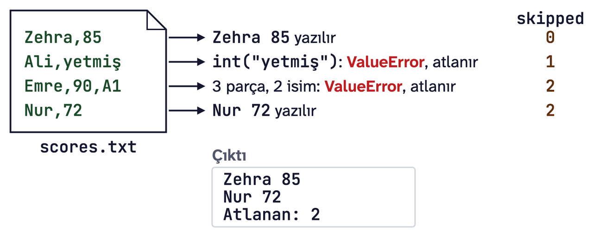</p>

`name, score = ...` satırı, split()'in verdiği iki parçayı iki isme atıyor; buna unpacking deniyor. Parça sayısı iki değilse unpacking de ValueError verir, aynı except onu da yakalar. `skipped` bir counter: her bozuk satırda bir artıyor. `open()`'a `encoding="utf-8"` yazmayı unutmayın; yazmazsanız Türkçe harfli bir file Windows'ta bozuk okunur.

**Sık yapılan hata:** başlık satırını da bozuk saymak. File'ın ilk satırı `name,score` gibi bir başlık olsaydı, `int("score")` da ValueError verirdi ve program `Atlanan: 3` yazardı. `transactions.csv`'de de başlık var ve bozuk sayılmıyor; hazır `load_transactions` başlık satırını `continue` ile geçiyor.

**Projede:** file okumayı ve `split()`'i sizin yazacağınız bir function'da kullanmıyorsunuz. Hazır `load_transactions` `transactions.csv`'yi böyle okuyor; her satırda beş parça var ve tutar bir int (tam sayı). try ve except ValueError'ı ise siz de `iban_valid`'de kullanacaksınız.

### File yoksa: FileNotFoundError

`open()` okumak için açacağı file'ı bulamazsa FileNotFoundError verir (Ders 4). Onu da try ve except yakalar. Aşağıdaki function, file yoksa boş bir list return ediyor.

```python
def read_names(file_name):
    names = []
    try:
        with open(file_name, encoding="utf-8") as f:
            for line in f:
                names.append(line.strip())
    except FileNotFoundError:
        return []
    return names


with open("names.txt", "w", encoding="utf-8") as f:
    f.write("Zehra\nEmre\n")

print(read_names("names.txt"))
print(read_names("missing.txt"))
```

```text
['Zehra', 'Emre']
[]
```

**Projede:** bunu sizin yazacağınız bir function'da kullanmıyorsunuz. Banka yeni açıldıysa `transactions.csv` henüz yoktur; hazır `load_transactions` o zaman `([], 0)` return ediyor. `with` satırı bu try'ın içinde duruyor, satırları okuyan ikinci try (ValueError) da onun içinde.

### İki değer return etmek: tuple ve unpacking

Bir function iki değeri bir tuple olarak return edebilir; call'un yapıldığı satırda unpacking ile iki isme ayrılır. `for` da her tuple'ı item'ları kadar isme açabilir.

```python
def count_and_total(amounts):
    count = 0
    total = 0
    for amount in amounts:
        count += 1
        total += amount
    return count, total


count, total = count_and_total([120, 80, 300])
print(count, total)

grades = [("Zehra", "MAT123", "A1"), ("Ali", "FIZ127", "B2")]
for name, course, grade in grades:
    print(name, grade)
```

```text
3 500
Zehra A1
Ali B2
```

<p align="center">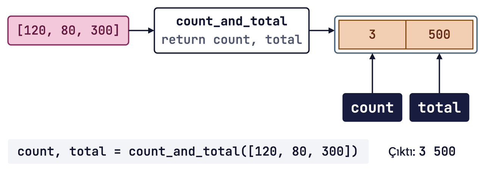</p>

`for` satırında `course`'u hiç kullanmadık ama yine de bir isim vermemiz gerekti: isim sayısı, tuple'ın item sayısını tutmalı. Tutmazsa, örneğin üç item'lı tuple'ları iki isme açarsanız, şu hata çıkar:

```text
ValueError: too many values to unpack (expected 2, got 3)
```

**Projede:** her para hareketi beş item'lı bir tuple; `balances` onları `for date, sender, receiver, amount, description in transactions:` ile açıyor. `password_ok` `(ok, message)` return ediyor; hazır `transfer`, `atm_withdraw` ve `add_alias` da öyle. Hazır `load_transactions` da `(transactions, skipped)` return ediyor.

**Sık yapılan hata:** for satırında function'ın bir parameter'ının adını yeniden kullanmak. for her turda o isme tuple'dan gelen değeri atar ve parameter'ın değeri kaybolur. Örneğin `card_id` parameter'ı olan bir function'da `for date, card_id, kind, merchant, category, amount in activity:` yazarsanız `card_id != card_id` hep False olur ve başka kartların hareketleri de girer; Python bir hata vermez. Başka bir isim seçin: `for date, owner, kind, merchant, category, amount in activity:` yazıp `owner != card_id` diye bakın. Hazır `transfer`'in parameter'ları da `sender`, `receiver`, `amount` ve `description`; o yüzden hareketleri `for date, who, to, value, text in transactions:` diye başka isimlerle açıyor.

### Dict'te toplamak: get()

Bir dict'in her key'i bir value tutar. Ders 5'teki `get(key, 0)`, key varsa onun value'sunu, yoksa 0 verir. Bir key ilk kez geldiğinde toplam 0'dan başlar.

```python
spent = {}
for name, amount in [("Zehra", 40), ("Ali", 25), ("Zehra", 15)]:
    spent[name] = spent.get(name, 0) + amount
print(spent)
print(spent.get("Emre", 0))
```

```text
{'Zehra': 55, 'Ali': 25}
0
```

<p align="center">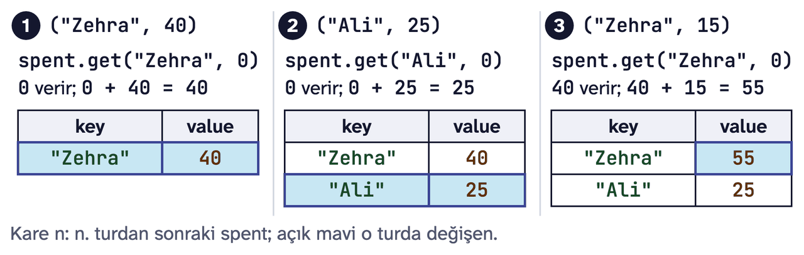</p>

Aynı satırda `+` yerine `-` yazarsanız value azalır; bir hesaptan çıkan para böyle düşülür.

**Sık yapılan hata:** key yokken doğrudan `spent[name] = spent[name] + amount` yazmak:

```text
KeyError: 'Zehra'
```

**Projede:** `balances` her hesabın bakiyesini, `category_totals` her kategorinin toplamını böyle biriktiriyor; `login` de üst üste yanlış denemeleri `failed` dict'inde `get()` ile sayıyor. Hazır `monthly_flow`'da value bir tuple: `flow.get(month, (0, 0))`.

### Başa eklemek: insert(0, ...)

`append()` bir değeri list'in sonuna, `insert(0, ...)` en başına ekler. Sırayla gelen değerleri hep başa eklerseniz list ters sırada olur: en son gelen en başta.

```python
days = ["Pazartesi", "Salı", "Çarşamba"]
newest_first = []
for day in days:
    newest_first.insert(0, day)
print(newest_first)
```

```text
['Çarşamba', 'Salı', 'Pazartesi']
```

<p align="center">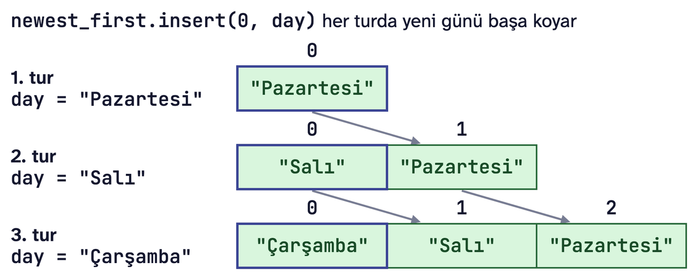</p>

**Projede:** `transactions.csv`'de hareketler eskiden yeniye sıralı. `account_history` her hareketi list'in başına ekleyerek en yenisini en üste getiriyor; hazır `update_recent` de son alıcıyı başa koyuyor.

### Dict içinde set

Bir dict'in value'su bir set de olabilir. Set her değeri bir kez tutar; `{name}`, içinde tek bir değer olan yeni bir set kurar. Aşağıdaki program her kulübe kimlerin yazıldığını tutuyor: Zehra Python'a iki kez yazılmış, ama bir kez sayılıyor.

```python
signups = [("Python", "Zehra"), ("Python", "Emre"),
           ("Satranç", "Zehra"), ("Python", "Zehra")]
people = {}
for club, name in signups:
    if club in people:
        people[club].add(name)
    else:
        people[club] = {name}
print(len(people["Python"]), len(people["Satranç"]))
print(people["Satranç"])
```

```text
2 1
{'Zehra'}
```

<p align="center">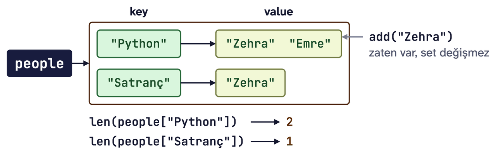</p>

Kulüp dict'te yoksa set'i `{name}` ile koyuyoruz, varsa `add()` ile ekliyoruz. Boş bir set ise `set()` ile kurulur; `{}` boş bir dict'tir.

**Projede:** `branch_report` her şubenin müşterilerini böyle topluyor. Zehra'nın TL ve USD hesabı aynı şubede, ama Zehra bir kez sayılıyor.

### Büyükten küçüğe sıralamak: 0 - total

`sort()` bir list'i küçükten büyüğe sıralar. Item'lar tuple ise önce ilk item'larına göre sıralanır; ilk item'lar eşitse ikinciye bakılır. Büyükten küçüğe dizmek için sayıyı eksiye çevirip öyle sıralayın: `0 - score`. 91, -91 olur ve küçükten büyüğe sırada en başa geçer. Sayının kendisi, eksi halini yine 0'dan çıkarınca geri gelir.

```python
scores = [(72, "Zehra"), (91, "Ali"), (85, "Emre")]
scores.sort()
print(scores)

ranking = []
for score, name in scores:
    ranking.append((0 - score, name))
ranking.sort()
print(ranking)

best, name = ranking[0]
print(name, 0 - best)
```

```text
[(72, 'Zehra'), (85, 'Emre'), (91, 'Ali')]
[(-91, 'Ali'), (-85, 'Emre'), (-72, 'Zehra')]
Ali 91
```

<p align="center">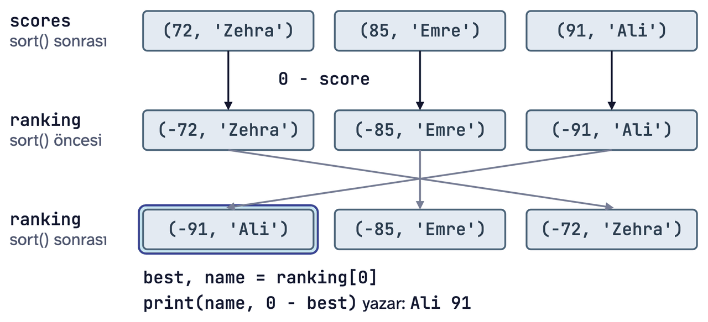</p>

**Sık yapılan hata:** `scores = scores.sort()` yazmak. `sort()` list'i yerinde sıralar ve None return eder; list kaybolur, `print(scores)` `None` yazar.

**Projede:** `branch_report` en büyüğü başa böyle getiriyor; hazır `top_categories` ve `budget_warnings` de öyle. `my_report`'ta en büyük harcamaları bulmak ya da kategorilere göre toplamları büyükten küçüğe dizmek için de aynı yolu kullanabilirsiniz.

### Kendi module'ünüzü import etmek

Ders 4'te `import math` deyip `math.sqrt()`'yi çağırdık. Bir module aslında bir .py file'ı; proje klasöründeki `security.py` ve `dates.py` de birer module. Python, `import dates` satırında `dates.py`'yi önce programın kendi klasöründe arar; bulunca içindeki function'lar `dates.` ile çağrılır. `import` satırına `.py` yazılmaz. Aşağıdaki program da proje klasöründe çalışmalı.

```python
import dates

print(dates.add_days("2026-11-28", 5))
print(dates.add_months("2026-11-30", 3))
```

```text
2026-12-03
2027-02-28
```

`add_days` iki argument (argüman) alıyor: bir tarih ve kaç gün ekleneceği. Ayın ve yılın kaç gün çektiğini kendisi hesaba katıyor. `add_months` ay ekliyor; 30 Şubat olmadığı için Şubat'ın son gününü verdi.

<p align="center">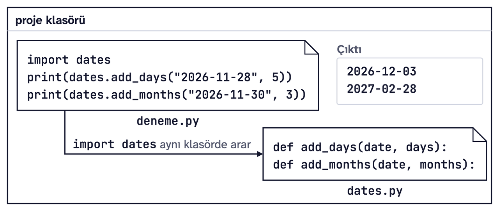</p>

**Sık yapılan hata:** `import` satırını unutmak:

```text
NameError: name 'dates' is not defined. Did you mean: 'bytes'?
```

Python'un önerdiği `bytes`'ın burada bir ilgisi yok; eksik olan `import dates` satırı. Uygulamanın hata kutusunda bu satırın yalnız ilk kısmı görünür.

**Projede:** `bank.py`'nin başına 2. görevde `import security`, 4. görevde `import dates` yazacaksınız. `import random` satırı orada hazır duruyor; onu hazır `atm_withdraw` kullanıyor. `testlerim.py` de `bank.py`'yi aynı yolla, `import bank` diye kullanıyor.

### File'a eklemek "a", baştan yazmak "w"

`"w"` file'ı her açışta önce boşaltır; `"a"` ise yazdığınızı file'ın sonuna ekler, eski satırlar yerinde kalır (Ders 4). `write()` satırı kendisi bitirmez; alanları virgülle ayırıp sona `\n` koymak size kalıyor, f-string bunu kolaylaştırır.

```python
for name in ["Zehra", "Ali"]:
    with open("visits.csv", "a", encoding="utf-8") as f:
        f.write(f"2026-11-08,{name}\n")

with open("visits.csv", encoding="utf-8") as f:
    for line in f:
        print(line.strip())
```

```text
2026-11-08,Zehra
2026-11-08,Ali
```

Programı bir kez daha çalıştırırsanız dört satır görürsünüz: `"a"` eski satırları silmez.

<p align="center">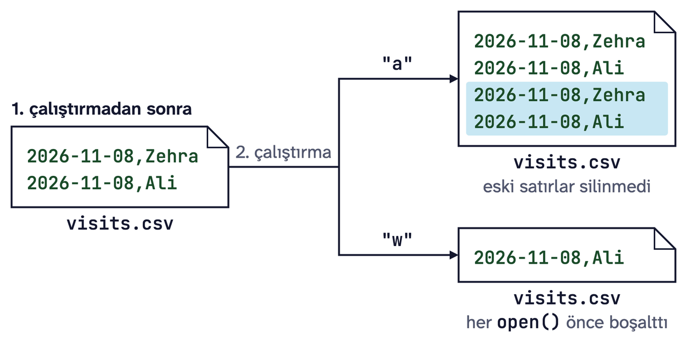</p>

**Sık yapılan hata:** `"a"` yerine `"w"` yazmak. `customers.csv` ya da `transactions.csv` `"w"` ile açılırsa içindeki bütün satırlar silinir. Böyle olursa uygulamadaki **Verileri ilk haline döndür** düğmesi file'ları geri getirir.

**Projede:** `register` yeni müşteriyi, `save_transaction` her para hareketini `"a"` ile ekliyor; hazır `add_alias` da yeni Kolay Adres'i öyle ekliyor. `change_password` ise bir müşterinin satırını değiştirmek için file'ı `"w"` ile açıp başlığı ve bütün müşterileri yeniden yazıyor.

### Str'de slicing

Slicing bir str'nin bir parçasını alır. `iban[4:9]`, index'i 4 olan karakterden başlar ve 9'dan önce durur: 4, 5, 6, 7 ve 8, yani beş karakter. Başı yazılmazsa en baştan (`iban[:2]`), sonu yazılmazsa sona kadar (`iban[10:]`) alınır. Aşağıdaki IBAN bankanın kurgusal verisinden, Eren'in TL hesabı.

```python
iban = "TR121234500102100200000001"
print(len(iban))
print(iban[:2], iban[2:4], iban[4:9])
print(iban[10:], iban[10:14])

date = "2026-11-08"
print(date[:7], date[8:])
```

```text
26
TR 12 12345
0102100200000001 0102
2026-11 08
```

IBAN'ın parçaları sırayla: ülke kodu TR, iki kontrol hanesi 12, banka kodu 12345, bir yedek hane (0) ve 16 haneli hesap numarası. Bu bankada hesap numarasının ilk dört hanesi şube kodu: 0102, Beytepe.

<p align="center">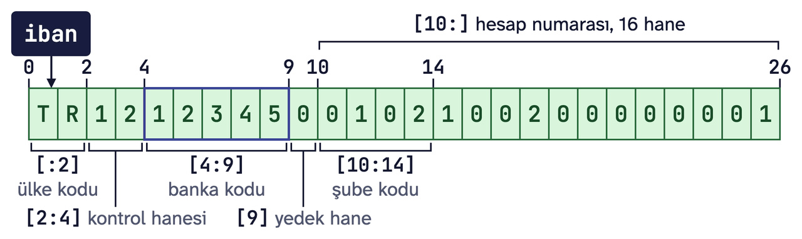</p>

**Projede:** `branch_report` şubeyi `iban[10:14]`'ten buluyor; hazır `transfer` da alıcının banka kodunu `receiver[4:9]`, şube kodunu `receiver[10:14]` ile alıyor. `date[:7]` bir tarihin ayını (`category_totals`, `places`; hazır `monthly_flow`), `today[8:]` gününü (hazır `due_orders`) veriyor.

### ord(), uzun bir sayı ve %

`ord()` bir karakterin kodunu verir (Ders 2). Büyük harflerin kodları alfabe sırasıyla artar: A 65, B 66 ve böyle Z'ye kadar. Bir harfi A 10, B 11, ..., Z 35 olacak biçimde sayıya çevirmek için `ord(char) - ord("A") + 10` yazılır.

`%` bölümden kalanı verir: `100 % 97` 3'tür. Python'un int'i 20, 30 basamaklı sayıları da tutar; `int()` rakamlardan oluşan uzun bir str'yi de sayıya çevirir. İçinde rakam olmayan bir karakter varsa ValueError verir.

```python
print(ord("A"), ord("B"), ord("T"))
for char in "TR":
    print(char, ord(char) - ord("A") + 10)

number = int("98765432109876543210")
print(number % 97)
print(100 % 97, 97 % 97)
try:
    print(int("123A5"))
except ValueError:
    print("Sayı değil")
```

```text
65 66 84
T 29
R 27
62
3 0
Sayı değil
```

<p align="center">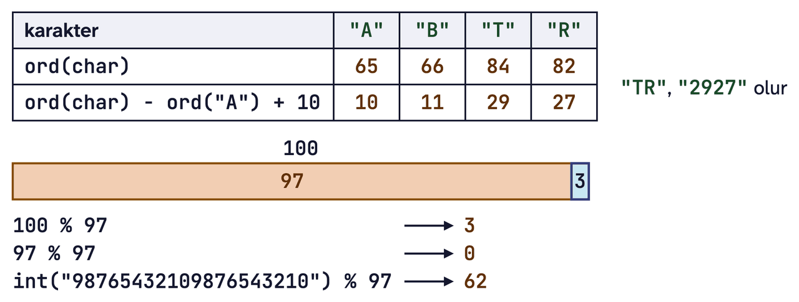</p>

**Sık yapılan hata:** `ord()`'a tek bir karakter değil, bütün bir str vermek. `print(ord("TR"))` şu hatayı verir; karakterleri bir for loop'uyla tek tek gezin.

```text
TypeError: ord() expected a character, but string of length 2 found
```

**Projede:** `iban_valid` IBAN'ın ilk dört karakterini sona taşıyor, harfleri `ord()` ile sayıya çeviriyor (TR, 2927 olur), çıkan uzun rakam str'sini `int()` ile sayıya çevirip 97'ye bölümünden kalana bakıyor: kalan 1 ise IBAN geçerli. Bir rakamı yanlış yazılmış IBAN bu kontrolden geçmez.

### Sondan saymak ve yıldızlamak: [-4:] ve "*" * 12

Eksi index sondan sayar: `card[-1]` son karakter, `card[-4:]` son dört karakter (Ders 2). `"*" * 12` aynı str'yi 12 kez yan yana yazar. Aşağıdaki kart numarası, kart şirketlerinin denemeler için yayımladığı bir numara.

```python
card = "4111111111111111"
print(card[-1], card[-4:])
hidden = "*" * 12 + card[-4:]
print(hidden)
print(len(hidden))
```

```text
1 1111
************1111
16
```

<p align="center">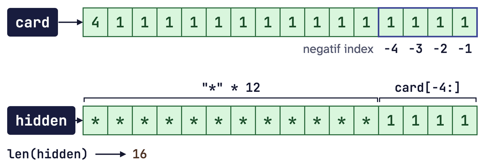</p>

**Projede:** `mask_iban` başkasının IBAN'ını ekranda yalnız ilk ve son dört karakteri görünecek biçimde gösteriyor; arada 18 yıldız var.

### Str method'ları: strip(), lower(), count(), split()

Str method'ları asıl str'yi değiştirmez, yeni bir değer return eder (Ders 2). `count()` bir parçanın kaç kez geçtiğini sayar; Ders 5'teki `split("@")` de str'yi @'tan parçalara bölüp bir list return eder.

```python
text = "  Emre@Ornek.Test "
email = text.strip().lower()
print(email)
print(email.count("@"), email.count("."))
name, domain = email.split("@")
print(name, domain)
print("tr12 3456".replace(" ", "").upper())
```

```text
emre@ornek.test
1 1
emre ornek.test
TR123456
```

**Projede:** `resolve_receiver` alıcı kutusuna yazılanı `strip()` ve `lower()` ile Kolay Adres'lerle karşılaştırıyor; IBAN'sa boşluklarını `replace()` ile siliyor ve `upper()` ile büyük harfe çeviriyor. Hazır `add_alias` e-postada tam bir tane @ olduğuna `count("@")` ile bakıyor, sonra e-postayı `split("@")` ile ikiye bölüyor; `password_ok` adınızın şifrede geçip geçmediğine `lower()` ve `in` ile bakıyor. `count()`'u ve `split()`'i yalnız hazır function'lar kullanıyor.

### Bulunca durmak: break

break içinde bulunduğu loop'u hemen bitirir (Ders 3). Aradığınızı bulduktan sonra list'in kalanına bakmanız gerekmiyorsa işe yarar.

```python
names = ["Zehra", "Emre", "Nur", "Batu"]
found = False
for name in names:
    print("Bakılan:", name)
    if name == "Emre":
        found = True
        break
print(found)
```

```text
Bakılan: Zehra
Bakılan: Emre
True
```

Nur'a ve Batu'ya hiç bakılmadı.

<p align="center">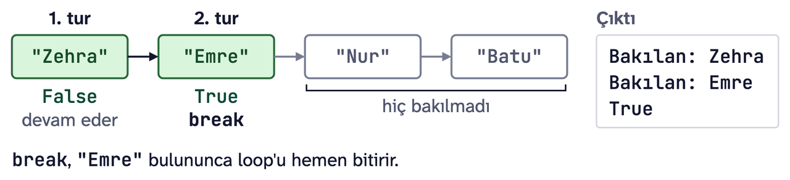</p>

**Projede:** `testlerim.py`'deki IBAN loop'u `while True` ile dönüyor ve boş satır gelince break ile bitiyor. Hazır `due_orders` da bir talimatın bugün ödenip ödenmediğini ararken ödemeyi bulunca break ile duruyor.

### Aynı list, iki isim: copy()

Bir list'i bir function'a verdiğinizde function'daki isim de aynı list'i gösterir (aliasing, Ders 5); function list'i değiştirirse sizin list'iniz de değişir. `copy()` ayrı, yeni bir list yapar.

```python
def add_guest(guests, name):
    guests.append(name)
    return guests


def add_guest_safe(guests, name):
    guests = guests.copy()
    guests.append(name)
    return guests


mine = ["Zehra"]
print(add_guest_safe(mine, "Emre"), mine)
print(add_guest(mine, "Emre"), mine)
```

```text
['Zehra', 'Emre'] ['Zehra']
['Zehra', 'Emre'] ['Zehra', 'Emre']
```

İlk satırda `mine` değişmedi: `add_guest_safe` kopyayla çalıştı. İkinci satırda `add_guest`, `mine`'ın kendisine ekledi.

<p align="center">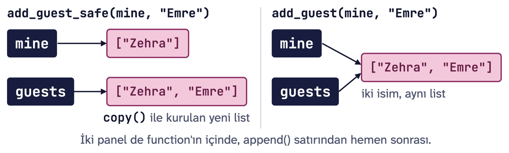</p>

**Projede:** bunu sizin yazacağınız bir function'da kullanmıyorsunuz. Hazır `update_recent` son gönderdikleriniz list'ini önce `recent.copy()` ile kopyalıyor; kopyalamasaydı uygulamanın elindeki list de değişirdi.

### Class, attribute ve method

Bir class kendi type'ınızı (tip) yazmanızı sağlar. `__init__` her yeni object'in (nesne) attribute'larını (özellik) kurar; method'lar `self` ile o object'in attribute'larını okur ve değiştirir. Bir method işi yapıp yapmadığını `True` ya da `False` return ederek söyleyebilir.

```python
class Bus:
    def __init__(self, seats):
        self.seats = seats
        self.passengers = 0

    def empty_seats(self):
        return self.seats - self.passengers

    def board(self, count):
        if count > self.empty_seats():
            return False
        self.passengers = self.passengers + count
        return True


bus = Bus(10)
print(bus.board(6), bus.passengers)
print(bus.board(5), bus.passengers)
print(bus.empty_seats())
```

```text
True 6
False 6
4
```

Yer yetmeyen biniş hiçbir şeyi değiştirmedi: `passengers` 6'da kaldı. `board`, aynı object'in öbür method'unu `self.empty_seats()` diye çağırıyor; bir method öbürünü böyle kullanabilir.

<p align="center">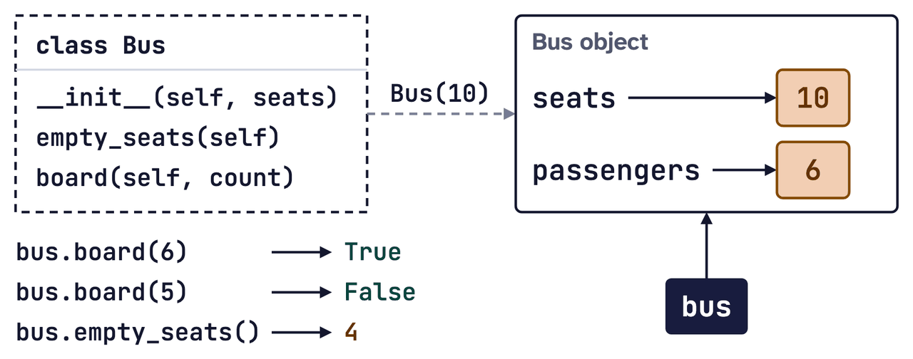</p>

**Sık yapılan hata:** method'un içinde `self.`'i unutmak. `passengers = passengers + count` yazarsanız Python `passengers`'ı method'un kendi variable'ı (değişken) sanar:

```text
UnboundLocalError: cannot access local variable 'passengers' where it is not associated with a value
```

**Projede:** 4. görevin `Card` class'ı `card_id`, `limit` ve `debt` attribute'larını tutuyor; `available()` kullanılabilir limiti return ediyor, `spend()` ve `pay()` işi yapamazsa hiçbir şeyi değiştirmeden `False` return ediyor. `replay_card` bir `Card` kurup kartın bütün hareketlerini sırayla uyguluyor.

### Set: &, | ve -

`a & b` iki set'te de olanları (kesişim), `a | b` en az birinde olanları (birleşim), `a - b` a'da olup b'de olmayanları (fark) verir (Ders 5). Boş bir set `set()` ile kurulur; tuple'lar da set'e girebilir.

```python
september = {"Kafe", "Sinema", "Kitapçı"}
october = {"Kafe", "Eczane"}
print(september & october)
print(october - september)
print(len(september | october))

empty = set()
print(empty, len(empty))
seen = {("2026-10-01", "Kafe", 80)}
print(("2026-10-01", "Kafe", 80) in seen)
```

```text
{'Kafe'}
{'Eczane'}
4
set() 0
True
```

Set'in sırası yoktur: birden çok değeri olan bir set'i yazdırdığınızda değerler her çalıştırmada başka sırada gelebilir.

**Sık yapılan hata:** boş set için `{}` yazmak. O boş bir dict'tir ve `add()`'i yoktur:

```text
AttributeError: 'dict' object has no attribute 'add'
```

**Projede:** `places` bir ayda harcama yapılan yerleri `set()` ile kurduğu bir set'e `add()` ile topluyor; `new_places` önceki ayların yerlerini `|` ile birleştirip bu ayınkilerden `-` ile çıkarıyor. `&` işaretini yalnız hazır `subscriptions` kullanıyor: her ay harcama yapılan yerlerin set'lerinin kesişimini alıyor. Hazır `double_charges` da gördüğü harcamaların `(date, merchant, amount)` tuple'larını bir set'te tutuyor: aynı tuple ikinci kez gelirse çift çekim.

### ** ve round()

`**` üs alır: `(1 + rate) ** 12`, `1 + rate`'in 12. kuvveti. `/` her zaman bir float verir. `round()` bir float'ı en yakın tam sayıya yuvarlar ve bir int verir; tam yarıda en yakın çift sayıyı seçer. Aşağıdaki program ayda yüzde 3 büyüyen 1000 TL'nin 12 ay sonraki halini hesaplıyor.

```python
money = 1000
rate = 3 / 100
print(money * (1 + rate) ** 12)
print(round(money * (1 + rate) ** 12))
print(round(2.5), round(3.5))
```

```text
1425.7608868461793
1426
2 4
```

**Sık yapılan hata:** parantezi unutmak. `**`, `+`'dan önce yapılır: `1 + 0.03 ** 12` önce `0.03 ** 12`'yi hesaplar ve 1.0 verir.

**Projede:** `loan_installment` eşit taksit formülünü `**` ile hesaplayıp `round()` ile yuvarlıyor; `buy_foreign` ve `sell_foreign` da TL tutarlarını `round()` ile tam sayı yapıyor, hazır `deposit_interest` ve `payment_plan` da öyle.

### Kaç tur döneceğini bilmeden: while

for bir list'in ya da `range()`'in sonunda durur. Kaç tur döneceğini baştan bilmediğiniz bir hesapta while kullanılır: şart doğru olduğu sürece loop döner (Ders 3). Aşağıdaki program ayda yüzde 10 büyüyen 1000 TL'nin kaçıncı ayda 2000 TL'yi geçtiğini buluyor.

```python
money = 1000
months = 0
while money < 2000:
    money = money + money * 10 / 100
    months += 1
print(months, round(money))
```

```text
8 2144
```

<p align="center">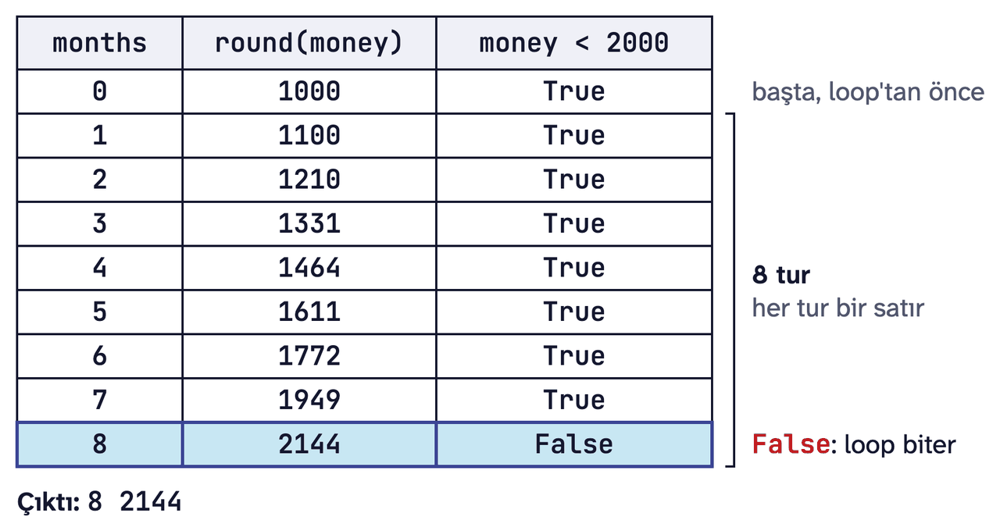</p>

**Sık yapılan hata:** şartı değiştiren satırı unutmak. `money` hiç büyümezse `money < 2000` hep True kalır ve loop hiç bitmez; böyle olursa PyCharm'daki kırmızı **Stop** düğmesiyle durdurun.

**Projede:** `months_to_goal` birikimin hedefe kaç ayda vardığını böyle sayıyor. Aylık birikim 0 olsaydı loop bitmezdi; uygulama bu yüzden aylık birikime 0 yazdırmıyor.

### Rastgele bir sayı: random.randint()

`random` Python'la gelen bir module (Ders 4). `random.randint(a, b)`, a ile b arasında (ikisi de dahil) rastgele bir int return eder; her call'da başka bir sayı çıkabilir.

```python
import random

print(random.randint(1, 6), random.randint(1, 6))
code = random.randint(100000, 999999)
print("Onay kodu:", code)
```

Bir çalıştırmanın çıktısı; sizde başka sayılar çıkar:

```text
6 1
Onay kodu: 677807
```

<p align="center">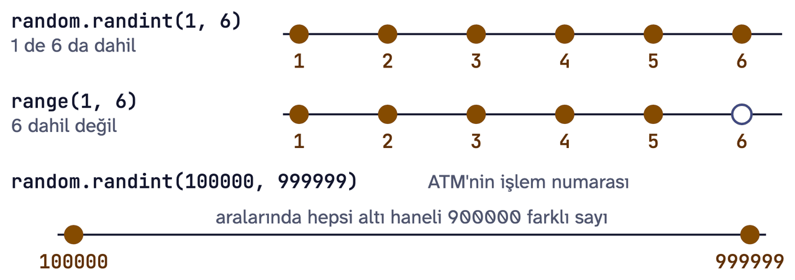</p>

**Sık yapılan hata:** `import random` satırını unutmak:

```text
NameError: name 'random' is not defined. Did you forget to import 'random'?
```

**Projede:** bunu sizin yazacağınız bir function'da kullanmıyorsunuz. Hazır `atm_withdraw` başarılı her çekime `random.randint(100000, 999999)` ile altı haneli bir işlem numarası veriyor. `import random` satırı `bank.py`'nin başında hazır duruyor; silerseniz uygulama para çekmeden önce satırın silindiğini söyler, `kontrol.py` de 5. görevin satırının altına bir uyarı yazar.

### Slicing'de adım: [-1::-2]

Slicing'in üçüncü sayısı adımdır (Ders 2): `[0::2]` baştan başlayıp birer karakter atlayarak gider. Adım eksiyse dilim sağdan sola gider: `[-1::-2]` son karakterden başlar ve sola doğru birer atlar, `[-2::-2]` sondan ikinciden başlar.

```python
digits = "123456"
print(digits[-1::-2])
print(digits[-2::-2])
print(digits[0::2])
```

```text
642
531
135
```

**Projede:** bunu sizin yazacağınız bir function'da kullanmıyorsunuz. Hazır `luhn_valid` kart numarasının sağdan 1., 3., 5. ... hanelerini `[-1::-2]` ile, 2., 4., 6. ... hanelerini `[-2::-2]` ile alıyor.

### assert

assert bir şartı sınar (Ders 3): şart True ise bir şey olmaz, program devam eder; False ise program AssertionError ile durur ve hangi satırda durduğunu söyler. Bir function'ın doğru çalıştığını, sonucunu bildiğiniz bir girdiyle denemek için kullanılır.

```python
def share(amount, people):
    return amount // people


assert share(100, 4) == 25
assert share(10, 3) == 3
print("İki test de geçti.")
assert share(10, 4) == 3
print("Bu satır yazılmaz.")
```

```text
İki test de geçti.
```

Son assert tutmadı: `10 // 4` 2'dir, 3 değil. Program o satırda durdu ve son print hiç çalışmadı; Run penceresinin en altında şu satır yazar:

```text
AssertionError
```

**Projede:** `testlerim.py`'ye en az beş assert yazın; bu assert'ler `bank.py`'deki en az üç farklı function'ı, docstring'lerdeki örneklerden başka girdilerle denesin. Beklenen sonucu kendiniz hesaplayın: function'ınızın verdiğini assert'e kopyalarsanız test hiçbir şeyi sınamaz.

## Meraklısına

Puansız. Bu fikirleri `bank.py`'yi bozmadan, ayrı bir file'da deneyin (örneğin `meraklisina.py`); orada `import bank` deyip kendi function'larınızı da çağırabilirsiniz. `bank.py`'deki function'ların adlarını, parameter'larını ve return ettiklerini değiştirmeyin: uygulama ve `kontrol.py` onlara bakıyor. Bazı fikirler `my_report`'a da uyar.

- **TC kimlik numarasının kontrol haneleri:** 11 hanenin ilki 0 olamaz, son ikisi öbürlerinden hesaplanır. 10. hane: 1, 3, 5, 7 ve 9. hanelerin toplamının 7 katından 2, 4, 6 ve 8. hanelerin toplamını çıkarıp `% 10` alınca çıkan sayı; 11. hane: ilk on hanenin toplamının `% 10`'u. Yalnız `11111111110` ve `10000000146` deneme numaralarıyla deneyin. Gerçek bir TC kimlik numarasını, kendinizinkini de, hiçbir file'a ve programa yazmayın.
- **KMH (kredili mevduat hesabı):** bakiyenin belli bir sınıra kadar eksiye inmesine izin veren bir hesap. Hazır `transfer`'in bir kopyasında bakiye kuralını buna göre değiştirin ve eksideki tutar için günlük faiz hesaplayın.
- **Limit artışı önerisi:** kuralı siz koyun, örneğin son üç ekstresini son ödeme gününe kadar tamamen ödeyen müşteriye yüzde 20 limit artışı önerilsin. `statement` ile `card_activity.csv`'deki ödemelere bakıp hangi kartların bu kurala uyduğunu bulan bir function yazın.
- **Kart puanı:** her kategoride 100 TL'lik harcamaya kaç puan verildiğini tutan bir dict (`{"market": 1, "yemek": 2, "kitap": 3}` gibi) ve bir ayın harcamalarından kazanılan puanı hesaplayan bir function: her harcama için `amount // 100 * points`.
- **Aylık e-ekstre:** bir kartın bir aylık harcamalarını `ekstre-4821-2026-10.txt` gibi bir file'a `"w"` ile, her harcama bir satırda olacak biçimde yazan ve sonuna toplamı ve asgari ödemeyi ekleyen bir function.
- **Loop'suz birikim hedefi:** faiz yoksa kaç ay gerektiği bir bölmeyle bulunur. Bölüm küsuratlıysa yukarı yuvarlamak gerekir; Ders 4'teki `math` module'ünde bunu yapan `math.ceil()` var: `math.ceil(1000 / 300)` 4 verir. Sonucu `months_to_goal(1000, 300, 0)` ile karşılaştırın.
- **Şifre önerisi:** `password_ok`'tan geçen rastgele bir şifre üreten bir function. `chr()`, `ord()`'un tersini yapar: `chr(ord("a") + 2)` `"c"` verir. Rastgele bir harfi `chr(ord("a") + random.randint(0, 25))` ile seçebilirsiniz.

## Teslim

Son gün: 30 Kasım 2026 Pazartesi, 23.59.

1. `kontrol.py`'yi son kez çalıştırın, `testlerim.py`'yi de bir kez **Run** edin; uygulamada her bölümü bir kez deneyin.
2. Kendi bankanızın iki ekran görüntüsünü alın: Hesaplarım'ı `ekran.png`, Raporum'u `raporum.png` adıyla proje klasörüne kaydedin. Windows'ta Windows + Shift + S, macOS'ta Command + Shift + 4 ile ekranın bir parçasını seçebilirsiniz. Windows'ta görüntüyü file olarak kaydetmek için köşede çıkan bildirime tıklayın. macOS'ta görüntü Masaüstü'ne düşer; onu proje klasörüne taşıyıp adını değiştirin.
3. Uygulamadaki **Verileri ilk haline döndür** düğmesine basın: denemelerinizde eklenen satırlar silinir, `data` klasörü ilk haline döner.

Sıradaki adımda bu README.md'yi sileceksiniz; kalan adımları projenin GitHub sayfasında okumaya devam edebilirsiniz.

4. `README-sablon.md`'yi doldurun. Önce ödevin açıklaması olan bu README.md'yi silin (açıklama GitHub'daki sayfada durmaya devam ediyor), sonra `README-sablon.md`'ye sağ tıklayıp **Refactor**, **Rename** ile adını `README.md` yapın.
5. Proje klasörünü zip'leyin: Windows'ta klasöre sağ tıklayıp zip'e sıkıştırma seçeneğini, macOS'ta **Sıkıştır**'ı seçin. `bank.py`, `testlerim.py`, `README.md`, `ekran.png`, `raporum.png` ve öbür file'lar içinde olsun.
6. [Teslim formunda](https://forms.gle/GoDQP1oTpEdeC2RD6) "İsim" alanına adınızı ve soyadınızı yazın, zip'i "Ödev dosyası" alanına yükleyin ve "Kişisel verileriniz" sorusundaki onay kutusunu işaretleyin. Tek başınıza yaptıysanız "Grup arkadaşlarınız" alanını boş bırakın. Zorunlu "Katkınız" alanına kendi payınızı, yani projede ne yaptığınızı yazın. Söylemek istediğiniz bir şey varsa isteğe bağlı "Açıklama" alanına yazabilirsiniz.
7. Grupla yaptıysanız gruptaki herkes formu kendi hesabından, aynı zip'le doldurur ve formun "Grup arkadaşlarınız" alanına öbür üyelerin adını ve soyadını yazar. "Katkınız" alanına da her üye kendi payını, yani projede kendisinin ne yaptığını yazar.

Takıldığınız bir yer olursa dersin WhatsApp grubuna yazın.

Dersin sitesi: https://natozenbilek.github.io/ieee-hacettepe-python-course/
